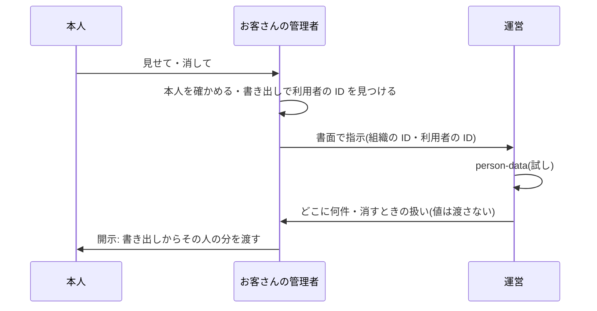

# 設計: 利用者1人分の開示・削除(手順書と運営のコマンドの試し)

> **AI 用の設計書。省略せずに網羅的に書く(正はこちら)。** 人はこれを開かず、PR の本文の「人向けのまとめ」を見る([guides/human-review.md](../guides/human-review.md))。
> 仕様: [docs/specs/0048-person-data.md](../specs/0048-person-data.md)
> 状態: 下書き
> 観点の順は [review-viewpoints.md](../review-viewpoints.md)。当てはまらない節も消さずに「該当なし(理由)」と書く。

## 0. 全体像

利用者を指す列の一覧(`PERSON_REFERENCES`。表・列・指し方・消すときの扱い・理由)を1か所に持ち、運営のコマンド `person-data <組織の ID> <利用者の ID>` がその一覧で1人分の行を数える(何も変えない)。一覧に無い列が DB に増えたら結合テストが落ちる。求めはお客さん(委託元)が受け、運営は指示で手伝う(手順書)。

## 作業の前に読んだ物(ガイド)

- 用語集・領域の説明: `docs/domain/glossary.md`・`docs/domain/organizations/README.md`
- ADR: 0013(監査ログは直さない)・0015(解約は運営のコマンド)・0018・0029(要配慮)・0039(開通。引数に個人情報を渡さない)・0041(契約の型)
- 既存のコード:
  - `apps/api/src/offboarding/delete-tenant.ts` … `TENANT_TABLES` と、足し忘れを落とす結合テストの型。ここも同じ形にした
  - `apps/api/src/db/classification.ts` … 列ごとの区分(personal の列がどこにあるか)
  - `apps/api/src/export/` … お客さんの管理者の書き出しに users(id・メール・名前・ロール)が入る → 利用者の ID はここで見つかる
  - `docs/legal/data-processing.md` … 自社は委託先(お客さんが委託元)
  - `docs/guides/data-retention.md` … 消した後に残る所と期間

## 1. 設計方針

- 置き場は `apps/api/src/person-data/`(`offboarding` と並ぶ運営の仕組み)。領域の入口は読まず、SQL で数える(表の持ち主・組織の文脈つき)。
- 一覧はコード(`PERSON_REFERENCES`)。扱い(匿名化・削除・残す)は「次の一歩で消すときの案」を兼ねる(U-2)。
- 新しい依存は無い。

## 2. データモデル

- 表・列は足さない(移行なし)。
- 一覧(15行): `legal.consents.user_id`(残す)・`legal.notices.user_id`(削除)・`organizations.email_changes.user_id`(削除)・`organizations.invitations.accepted_user_id`(匿名化)・`.email`(匿名化。メールで指す)・`.invited_by`・`.revoked_by`(残す)・`organizations.support_grants.granted_by`・`.revoked_by`(残す)・`organizations.support_sessions.staff_user_id`(残す)・`organizations.users.id`(匿名化)・`platform.audit_events.actor_id`(残す)・`platform.feature_usage.user_id`(削除)・`platform.outbox.payload`(削除。`userId`・`completedBy` で指す)・`projects.projects.created_by`(残す)。
- 守り(結合テスト): `information_schema` で uuid の列のうち名前が `…_by`・`…user_id`・`actor_id` の物が、全部一覧にあること。一覧の表は全部 `TENANT_TABLES` にあること。

## 3. API

- 該当なし(API は作らない)。
- CLI: `node dist/cli.js person-data <組織の ID> <利用者の ID>` → `{"mode":"plan","tenantId","userId","found","cognitoSub","lines":[{"table","column","by","action","why","rows"}],"totals":{"anonymize","delete","keep"}}`。件数が0の列は出さない。いなければ `found: false` と1行の文。

## 4. 状態遷移

- 該当なし(何も変えない)。

## 5. システム間連携

- Cognito: 触らない(sub を出すだけ。消すのは手順書の 5 で人が)。
- ECS: 移行と同じ1回きりのタスク。引数は ID だけ。

## 6. 業務ルール

- 数えるのは `tenant_id` が渡した組織の行だけ(組織の文脈+条件の両方)。
- その組織の users に行が無ければ、何も数えずに `found: false`(他社にいるかは言わない)。
- メールで指す列は、その人の**いまの**メールで数える(古いメールの招待は数えない。U-2 の次の一歩で、メールの変更の記録から古いメールも数えるかを決める)。
- 送信待ちは中身の `userId`・`completedBy` で数える(`taskId` など、人を指さない ID は見ない)。

## 7. 要求との対応

| 受け入れ条件(仕様) | 設計のどこ | テスト |
|---|---|---|
| 表・列ごとの件数と扱い・何も変えない | 2・3 | `person-data.int.test.ts`「その人の行が」「何も変えない」 |
| 引数は ID だけ・UUID でなければ止める | 3 | `cli.ts`(形を確かめる) |
| 値を出さない・sub を出す | 3 | 「出力に名前・メールの値は入らない」「Cognito と結びついていれば」 |
| その組織だけ・いない人は言わない | 6 | 「ほかの組織の行は数えない」「その組織にいない人」 |
| 列が増えたら落ちる | 2 | 「利用者の ID を持つ列は、全部 PERSON_REFERENCES にある」「一覧の表は解約で消す表」 |
| 手順書 | — | `docs/runbooks/person-data.md` |
| 誰が答えるか | U-1 | `docs/legal/data-processing.md` の 5-2 |
| カタログ | — | `pnpm kit:catalog` |

## 8. 非機能

- 性能: 1人分で十数本の数える SQL。大きな表(監査ログ)は `tenant_id` で絞る(索引 `audit_events` の組織と時刻)。運営が手で流すだけ。
- セキュリティ: 仕様の STRIDE。出力は ID と数だけ。
- 運用: 手順書 `docs/runbooks/person-data.md`。
- 費用: なし。

## 9. このプロダクト特有

| 観点 | この変更では |
|---|---|
| テナント分離 | 組織の文脈と条件で絞る。結合テスト |
| 権限の表 | 変わらない(API なし) |
| 監査ログ | 残さない(読むだけのコマンド。運営の作業の記録は手順書で)。消す次の一歩では残す |
| 解約で消す一覧 | 一覧の表は全部 `TENANT_TABLES` にあることをテストで確かめる |
| サポートの代理ログイン | 社員の入室の記録(`staff_user_id`)も一覧に入れた(社員の行は「残す」) |
| ログの個人情報 | 出さない |
| 列の分類(`personal` / `sensitive`) | 列は足さない |
| 画面の部品 | 該当なし |

## 10. 観点ごとの扱い

| 観点 | 扱い | 理由 |
|---|---|---|
| 設計方針 | 採用 | まず試しと手順書(ADR 0059)。解約と同じ「一覧+足し忘れのテスト」 |
| 業務ルール | 最重要 | 誰が答えるか・消すときの扱い(U-1・U-2) |
| データモデル | 軽く確認 | 表は足さない。一覧が正しいか |
| 要求との対応 | 機械で検証 | 結合テスト |
| 非機能 | 軽く確認 | 値を出さない |
| API・状態遷移・連携 | 低優先 | 無い |

## 11. 決めたこと(AI が決めた。人に聞かなかった)

- 引数は組織の ID と利用者の ID — 開通と同じく、名前・メールを CloudTrail に残さない。利用者の ID は、お客さんの管理者が自分の書き出し(users の id)で見つけられる。
- 何も変えない試しだけにする — 仕様の範囲(まずは試し)。消す扱いは人の承認が要る(U-2)。
- 一覧はコードに持ち、DB の列から足し忘れを見つける — 解約の `TENANT_TABLES` と同じ守り。名前の決まり(…_by・…user_id・actor_id)は今の表の付け方に合わせた。
- 件数0の列は出さない — 出力を短くし、見落としを減らす。
- その組織にいなければ数えない — 他社にいるかを言わない(列挙を防ぐ)。

## 12. 未確定事項(AI の仮決め。人の承認と分けて追う)

> 4つに当たる判断だけ。状態の書き方は [guides/human-review.md](../guides/human-review.md) の 2。`pnpm decisions` がここを読む。**`仮決め` が残る PR はマージしない。**

| 番号 | 工程 | 種類 | 仮決め(設計した事実) | なぜそうしたか | 人が判断する問い | 状態 |
|---|---|---|---|---|---|---|
| U-1 | 設計 | 他チームとの契約や制約 | 本人からの求めは**お客さん(委託元)が受けて答え**、運営(委託先)はお客さんの管理者の書面の指示で手伝う。本人から運営に直接来たら、お客さんへ回す(本人に「あなたの会社の管理者へ」と伝える) | 取り扱いの取り決めの型(0. 自社の立場)で、お客さんの業務のデータは委託先として扱う。本人が誰かを確かめられるのはお客さん | この分担でよいか(自社が直接答える契約の形を取るなら、受付と本人確認を運営が持つ) | 仮決め |
| U-2 | 設計 | 戻せないリスク | 消すときの扱いの案: 本人の行(users)と招待のメールは**匿名化**、本人だけの記録(お知らせ・メールの変更・利用の記録・送信待ち)は**削除**、監査ログ・規約への同意・作った人や許可した人の ID は**残す**(値は入っていない) | ほかの行が本人を指しているので、users は消さずに値を置き換える。監査ログと同意は法令・契約の証拠で、値を持たない | 残す物(監査ログ・同意の記録)を残してよいか。匿名化の置き換え方(名前「削除した利用者」・メール「deleted-<ID>@invalid」) | 仮決め |
| U-3 | 設計 | 事業判断 | 開示の中身は、お客さんの管理者が自分の書き出し(JSON)からその人の分を抜き出して本人に渡す。運営は値を見ず・作らず、どこに何件あるか(試しの結果)だけを渡す | 運営が値を扱う道を増やさない(AI-6 と同じ考え)。書き出しはもう、組織の全部の個人データを含む | この形でよいか(運営が1人分の書き出しを作る道が要るか) | 仮決め |

## 13. 作り直しの記録

| 日付 | きっかけ | 入った工程 | 直した物 | 作り直した下流 |
|---|---|---|---|---|
