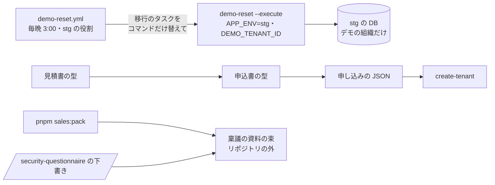

# 設計: 営業の道具(毎晩戻るデモの組織・見積から申込・稟議の資料の束)

> **AI 用の設計書。省略せずに網羅的に書く(正はこちら)。** 人はこれを開かず、PR の本文の「人向けのまとめ」を見る([guides/human-review.md](../guides/human-review.md))。
> 仕様: [docs/specs/0053-sales-kit.md](../specs/0053-sales-kit.md)・ADR: [0064](../adr/0064-sales-kit-demo-on-stg.md)
> 状態: 承認済み(@attumkwg 2026-10-25。会話で回答。U-1 は「既定として承認」= 導入時に決める)
> 観点の順は [review-viewpoints.md](../review-viewpoints.md)。

## 0. 全体像

3つを足す。① 運営のコマンド `demo-reset`(`apps/api/src/demo/reset.ts`)と毎晩のワークフロー `demo-reset.yml`: stg のデモ用の組織を、組織・人・プラン・機能・同意・監査ログを残したまま、決まったデモのデータに戻す。② 見積書の型(`docs/legal/quote.md`)と、見積 → 申込 → 開通でプランと価格表の版をそろえる流れ(`docs/guides/sales.md`)。③ 稟議の資料の束を作るスクリプト `pnpm sales:pack`(`scripts/sales-pack.mjs`)。



## 作業の前に読んだ物(ガイド)

- `apps/api/src/offboarding/delete-tenant.ts` の `TENANT_TABLES`(組織の行のある表・子から先の順)・`apps/api/src/db/seed.ts`(種データの作り方・本番の個人データは使わない)
- `apps/api/src/cli.ts`(運営のコマンドの並べ方・`APP_ENV` の既定は `local`)・`apps/api/src/plans/command.ts`(仕組みの監査ログ `recordAudit` と `MANUAL_AUDIT_ACTIONS`)
- `.github/workflows/deploy.yml`・`.github/scripts/run-migration.sh`(stg のデプロイの役割・移行のタスク `<cluster>-migrate` を run-task する形)・`infra/terraform/envs/stg/github.tf`(デプロイの役割は `ecs:RunTask` と移行のタスクの役割の `iam:PassRole` を持つ・environment stg だけ)・`infra/terraform/modules/ecs-service/main.tf`(移行のタスクのコンテナ名 `migrate`・環境変数に `APP_ENV` が無い)
- `docs/legal/README.md`・`order-form.md`・`sla.md`・`data-processing.md`(型の形)・`docs/runbooks/tenant-provisioning.md`・`plans.md`(プラン・価格表の版・申し込みの JSON)・`.claude/skills/security-questionnaire/SKILL.md`(下書きはリポジトリの外)
- 場面 8-5

## 1. 設計方針

- デモは **stg** の1つの組織(依頼)。本番には置かない。手元・プレビューでも試せる。
- 戻すのは今ある「移行のタスク」をコマンドの上書きで流す(新しいタスク定義・役割・infra を足さない。stg のデプロイの役割が `ecs:RunTask` を持つ)。
- 戻す表は `TENANT_TABLES` から「残す表」を引いて作る(プロダクトが表を足せば、自動で戻す側に入る)。
- 見積は型(文面を書かない。`docs/legal/` と同じ形)と手引きだけ。金額はキットに無い。
- 束は型をまとめるだけのスクリプト(依存は node の標準だけ)。会社ごとの中身は人がリポジトリの外で足す。

## 2. データモデル

DB は変えない。

戻す表(`DEMO_RESET_TABLES` = `TENANT_TABLES` のうち、残す表と `sensitive.` で始まる表を除いた物。順は `TENANT_TABLES` のまま = 子から先):

| 残す(戻さない) | 理由 |
|---|---|
| `organizations.tenants`・`organizations.users` | デモのログイン(Cognito の利用者と結びついている)をそのまま使う |
| `platform.tenant_plans`・`platform.feature_flags` | 見せるプランと機能は運営が選んだ物 |
| `legal.consents`・`legal.notices` | 毎晩同意の画面に回されないため |
| `platform.audit_events` | 足すだけの記録(消すには解約の手順が要る) |
| `sensitive.*` | デモに要配慮を置かない(触らない) |

デモのデータ `DEMO_DATA`(`apps/api/src/demo/reset.ts`): 計画の名前とタスクの題名・完了だけ(偽)。計画の作った人は、その組織の最初の管理者(作った順で最初の `admin`)。

監査ログの名前 `demo.reset`(`MANUAL_AUDIT_ACTIONS.demoReset`。画面の文「デモのデータを戻した」)。行為者は仕組み・対象は組織・`details.tables` に戻した表の数。

## 3. API

API は足さない。

コマンド `node dist/cli.js demo-reset [--execute]`:

- 環境: `APP_ENV`(`local`・`test`・`preview`・`stg` のどれかを**はっきり**書く。無ければ止まる)・`DEMO_TENANT_ID`(要る)・`SUPPORT_TENANT_ID`(同じなら止まる)
- 出す行: `{"mode":"plan"|"reset","removed":{"<表>":<数>,…},"inserted":{"projects":N,"tasks":N}}`(試しは案内の行も)。組織と人の ID は出さない

ワークフロー `.github/workflows/demo-reset.yml`:

| 項目 | 中身 |
|---|---|
| いつ | 毎晩 `0 18 * * *`(日本時間 3:00)・手動 |
| 条件 | 定期は `vars.KIT_ROLE == 'product'`・main だけ・`vars.DEMO_TENANT_ID` と `vars.AWS_STG_DEPLOY_ROLE_ARN` がある |
| 権限 | `contents: read`・`id-token: write`。Environment `stg` |
| すること | stg のデプロイの役割を引き、`<cluster>-migrate` を `--overrides` で `command: ["dist/cli.js","demo-reset","--execute"]`・`APP_ENV=stg`・`DEMO_TENANT_ID` にして run-task。止まるのを待ち、終わりの番号が 0 でなければ失敗 |

`pnpm sales:pack --out <ファイル>`: 下の 6 の S-1〜S-4。書き出す先がリポジトリの中なら注意を出す(止めない)。

## 4. 状態遷移

デモの組織: 使われて散らかる → 毎晩(か手で)戻る → 決まったデモのデータ。戻すたびに監査ログに1行。

## 5. システム間連携

- stg の ECS(run-task)と stg の DB だけ。外のサービスは増えない。
- 束は手元のファイルを読むだけ。

## 6. 業務ルール

デモ:

- **D-1 環境**: `APP_ENV` が `local`・`test`・`preview`・`stg` のどれかで、**環境変数として書かれている**ときだけ(移行のタスクは `APP_ENV` を持たないので、ワークフローが上書きで渡す)。`prod` や無いときは止まる。
- **D-2 組織**: `DEMO_TENANT_ID` の組織に管理者がいなければ止まる(先に `create-tenant`)。運営の組織は指せない。
- **D-3 戻す**: 1つのトランザクションで、戻す表のその組織の行を消し(順は子から先)、`DEMO_DATA` を入れ、監査ログに1行。途中で失敗したら何も変わらない。何度流しても同じ形になる。
- **D-4 試し**: `--execute` が無ければ、表ごとの行の数と入れる数を数えるだけ。
- **D-5 デモの中で増えた人**: 残る(人の表は戻さない)。消すのは人(`person-data` の手順)。
- **D-6 見込み客**: デモは営業が画面を見せる。見込み客に stg のアカウントを渡さない(U-1)。

見積から申込:

- **Q-1**: 見積・申込書・申し込みの JSON で、プランの名前(`PLANS` の id)と価格表の版(`PRICE_LISTS` の id)をそろえる。
- **Q-2**: 見積の有効期限の既定は出した日から 30日(案。型の「使う人が決めること」)。過ぎたらそのときの価格表の版で出し直す。

束:

- **S-1 並び**: 仕組みの事実(`docs/legal/README.md` の「## 2.」の節)・`docs/legal/sla.md`・`docs/legal/data-processing.md`・`docs/compliance/vendors.md`。
- **S-2 埋める所**: 行の中の `<…>`(40文字まで)・`YYYY`・`◯`・「仮の既定」。インラインのコード(`` `…` ``)とコードの塊(```)の中は数えない。どの型の何行目かを出す。
- **S-3 整え**: HTML の注を落とす。キットの中へのリンクは文だけ(外の URL は残す)。
- **S-4 頭**: 作った日(日本時間)・キットの版(`git rev-parse --short HEAD`。無ければ版不明)・専門家に確かめる・質問票の下書きを後ろに付ける・会社ごとの条件は契約の側に残す、の注。

## 7. 要求との対応

| 受け入れ条件(仕様) | 設計のどこ | テスト |
|---|---|---|
| 試し → 本番で戻す・デモのデータを入れ直す | 6. D-3・D-4 | `apps/api/test/integration/demo-reset.int.test.ts` の「試しは数えるだけ…」 |
| 組織・人・プラン・機能・同意・監査ログを残す・監査ログに残る | 2.・6. D-3 | 同上(人の数がそのまま・`demo.reset` が1行)・`test/unit/demo-reset.test.ts` の「戻す表」 |
| 環境と組織の決まりで止まる | 6. D-1・D-2 | 単体の「デモを戻してよい環境」・結合の「コマンドの入口」(prod・無い組織) |
| ほかの組織に触れない・ID を出さない | 6. D-3・3. | 結合の「試しは…」(ほかの組織の計画とタスクがそのまま)・「コマンドの入口」 |
| 毎晩 stg で自動で戻る | 3. のワークフロー | `pnpm setup:check`(定期の見分け `KIT_ROLE`)・CI の actionlint と zizmor |
| 見積書の型と流れ | 6. Q-1・Q-2 | 文書(`docs/legal/quote.md`・`docs/guides/sales.md` の 2) |
| 束をまとめる・埋める所・リンク・無いファイル | 6. S-1〜S-4 | `scripts/sales-pack.test.mjs`(4本。いまのキットの型で作れることも) |

## 8. 非機能

- 性能: デモの1組織だけを1トランザクションで。夜中に1回。
- セキュリティ: 仕様の STRIDE のとおり。ワークフローは stg の役割だけ・main だけ・Environment stg。コマンドは環境を二重に確かめる。
- 運用: 手引き `docs/guides/sales.md`・変数は `docs/guides/manual-setup.md`。失敗したら CloudWatch Logs の `migrate`。
- 費用: 毎晩 Actions 1〜2分と Fargate の小さなタスク1回。

## 9. このプロダクト特有

| 観点 | この変更では |
|---|---|
| テナント分離 | `withTenant` でデモの組織だけを読み書きし、どの表も `tenant_id` で絞る |
| 権限の表 | 該当なし(API が無い) |
| 監査ログ | デモの組織に `demo.reset`(仕組み)を足す。画面の文も足した |
| 解約で消す一覧 | 該当なし(表を足さない。戻す表は `TENANT_TABLES` から作る) |
| サポートの代理ログイン | 代理ログインの許可と入室の記録も戻す(デモの中で見せた物を残さない) |
| ログの個人情報 | 出す行に ID を出さない |
| 列の分類(`personal` / `sensitive`) | 列を足さない。要配慮の表は触らない |
| 画面の部品 | 該当なし |

## 10. 観点ごとの扱い

| 観点 | 扱い | 理由 |
|---|---|---|
| 設計方針 | 採用 | stg の移行のタスクを上書きで流す(infra を足さない。ADR 0064) |
| データモデル | 採用 | 残す表と戻す表の分け方 |
| API | 低優先 | 足さない |
| 状態遷移 | 軽く確認 | 戻すだけ |
| システム間連携 | **最重要** | 本番に届かないこと(役割・環境・`APP_ENV` の三重) |
| 業務ルール | 採用 | 見込み客にアカウントを渡さない(U-1) |
| 要求との対応 | 機械で検証 | 単体2本・結合2本・束4本 |
| 非機能 | 軽く確認 | 夜中に1回 |

## 11. 決めたこと(AI が決めた。人に聞かなかった)

- 戻すのは今ある stg の移行のタスクをコマンドだけ上書きして流す — 新しいタスク定義・役割を足すと infra の apply が要る。デプロイの役割は移行のタスクの run-task と役割の受け渡しを持っている
- コマンドは `APP_ENV` を**はっきり**求める — 移行のタスクは `APP_ENV` を持たず、`cli.ts` の既定は `local` なので、既定に頼ると本番の移行のタスクでも通ってしまう。ワークフローが `APP_ENV=stg` を渡す
- 戻す表は `TENANT_TABLES` から残す表を引く — プロダクトが表を足しても戻し忘れない。順も解約の削除と同じ(子から先)
- 人・プラン・機能・同意・監査ログを残す — デモのログインと見せる構成を毎晩作り直さない。監査ログは足すだけの記録
- デモのデータはコードの中の偽の題名(`DEMO_DATA`) — 種データと同じく本番の個人データを使わない。プロダクトに合わせて直す所
- 毎晩 3:00 — 商談の時間に重ならない
- 見積は型と手引きだけ — 金額はキットに持たない(価格表の金額は会計ソフト。仕様 0047)
- 束は Markdown 1つ — 稟議の資料はお客さんの側で Word や PDF にされることが多い。Markdown なら写しやすい。PDF にするのは人
- 束に質問票の答えを入れない — 会社ごとの答えはリポジトリの外(`/security-questionnaire` の決まり)
- ADR を1つ書く — デモを stg に置いてワークフローで戻す形は、後から変えにくい

## 12. 未確定事項(AI の仮決め。人の承認と分けて追う)

> 4つに当たる判断だけ。状態の書き方は [guides/human-review.md](../guides/human-review.md) の 2。`pnpm decisions` がここを読む。**`仮決め` が残る PR はマージしない。**

| 番号 | 工程 | 種類 | 仮決め(設計した事実) | なぜそうしたか | 人が判断する問い | 状態 |
|---|---|---|---|---|---|---|
| U-1 | 設計 | 利用者の挙動 | デモは**営業が画面を見せる**形にし、**見込み客に stg のデモのアカウントを渡さない**(見込み客の名前・メールアドレスを stg に入れない)。見込み客に触ってもらうなら、試用の組織を本番に `create-tenant` で作る | stg は本番ほど守っていない(費用を抑えた作り)。見込み客のアカウントを作ると、個人データが stg に入り、毎晩戻しても人の表には残る | 商談で見込み客に自分で触ってもらうか。触ってもらうなら、stg のデモに共有のアカウント(営業の会社のアドレス)を渡すか・本番に試用の組織を作るか | 導入時に決める(キットの既定は @attumkwg 2026-10-25 に承認。会話で回答) |

## 13. 作り直しの記録

| 日付 | きっかけ | 入った工程 | 直した物 | 作り直した下流 |
|---|---|---|---|---|
