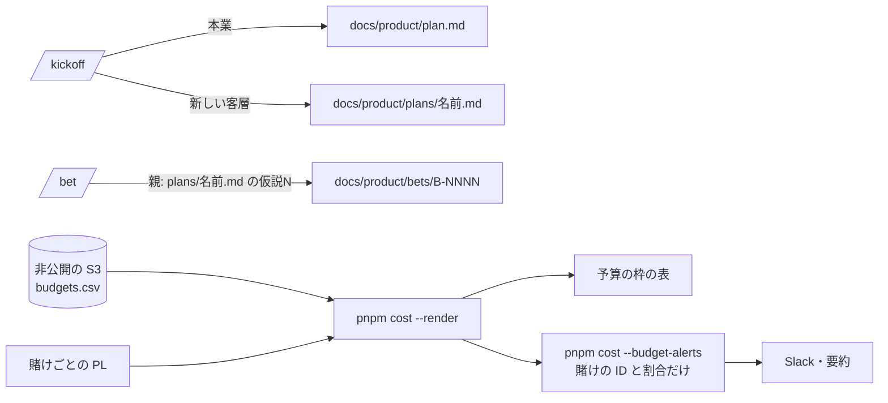

# 設計: 2つ目の客層の計画の置き場と、賭けの予算の枠

> **AI 用の設計書。省略せずに網羅的に書く(正はこちら)。** 人はこれを開かず、PR の本文の「人向けのまとめ」を見る([guides/human-review.md](../guides/human-review.md))。
> 仕様: [docs/specs/0054-plans-and-bet-budgets.md](../specs/0054-plans-and-bet-budgets.md)・ADR: [0065](../adr/0065-bet-budgets-from-private-inputs.md)
> 状態: 下書き
> 観点の順は [review-viewpoints.md](../review-viewpoints.md)。

## 0. 全体像

① 計画の置き場: 本業は `docs/product/plan.md` のまま、2つ目からの客層は `docs/product/plans/<名前>.md`(同じ形)。`/kickoff` と `/bet` が選ぶ。② 予算の枠: 非公開の入力 `budgets.csv`(賭けごとの月の枠)を、費用のページ(`scripts/cost/budgets.mjs`)が賭けごとの PL と比べて状態を出し、`cost.yml` が注意の線を超えた賭けを ID と割合だけで Slack に知らせる。



## 作業の前に読んだ物(ガイド)

- `docs/guides/bets-and-assets.md` の「2段の入れ子」(新しい客層は `/kickoff` からもう一度)・「リポジトリに置く物・置かない物」(金額は置かない)
- `.claude/skills/kickoff/SKILL.md`(まず確かめる・OK の後に書く)・`.claude/skills/bet/SKILL.md`(親の書き方)・`docs/product/_template.md`・`scripts/setup/next-steps.mjs`(`plan.md` があるかだけを見る)
- 費用のページ: `scripts/cost/pl.mjs`(賭けごとの `infra`・`saas`・`shared`・`people_high`)・`summary.mjs`・`render.mjs`・`run.mjs`・`source-people.mjs` の `readInputs`・`.github/workflows/cost.yml`・`docs/guides/cost-dashboard.md`・ADR 0032
- `.github/workflows/checkup.yml`(秘密 `SLACK_WEBHOOK_URL` で Slack に送る形)
- 場面 1-7・4-7

## 1. 設計方針

- 計画は**ファイルを増やすだけ**。本業の `plan.md` の場所を変えない(読む所が多い。`next-steps.mjs`・スキル)。検査は足さない(計画のファイルは自由な文書)。
- 予算の枠は**金額なので非公開の入力**(時給・売上と同じ)。費用のページの今の PL の数を使い、新しい集め方を足さない。
- 知らせは今ある Slack の秘密を使い、**賭けの ID と割合だけ**を出す。
- 新しい依存は無い。

## 2. データモデル

DB は触らない。

`docs/product/plans/<英語の短い名前>.md`: `docs/product/_template.md` と同じ形。置き場の説明は `docs/product/plans/README.md`。

非公開の入力 `cost/inputs/budgets.csv`:

| 列 | 意味 |
|---|---|
| `bet` | `B-NNNN` |
| `monthly_jpy` | 月の枠(円・0より大きい) |
| `from`・`until` | `YYYY-MM`(その月を含む) |
| `warn_pct` | 知らせる線(1〜100。空なら 80) |

`summary.json` に `budgets` を足す(足すだけ):

```json
{"rows":[{"bet":"B-0002","monthly_jpy":100000,"until":"2027-03","spent_jpy":35000,"projected_jpy":98000,"pct":98,"warn_pct":80,"status":"warn"},
         {"bet":"B-0004","monthly_jpy":10000,"until":"2026-09","status":"ended"}],"bad":0}
```

## 3. API

API は足さない。

- `pnpm cost --render <dir> --inputs <dir>` が `budgets.csv` を読み、`summary.json` とページに出す。
- `pnpm cost --budget-alerts <dir>`: `<dir>/summary.json` から、知らせの文を1行ずつ出す(無ければ何も出さない)。
- `cost.yml` の「予算の枠の知らせ」: 文があれば、非公開のリポジトリなら要約に、`SLACK_WEBHOOK_URL` があれば Slack に(`{"text": …}`)。

## 4. 状態遷移

枠の状態(その月ごとに計算): `ok` → `warn`(見込みが注意の線以上)→ `over`(見込みが枠以上)。期間の後は `ended`。始まる前の枠は出さない。

計画: 書く(`/kickoff`)→ 結果を持ち帰って書き換える → やめたら「これまでの判断」に `やめる`(ファイルは消さない)。

## 5. システム間連携

- Slack の Incoming Webhook(今ある秘密 `SLACK_WEBHOOK_URL`。委託先の台帳に Slack は「ID と集計だけ」で載っている)。送るのは賭けの ID・月・割合。
- 非公開の S3(人が置く・`cost.yml` が落とす)。

## 6. 業務ルール

計画:

- **P-1**: 本業 = `docs/product/plan.md`。2つ目から = `docs/product/plans/<名前>.md`(1つの客層に1つ)。
- **P-2**: `/kickoff` は、計画があって新しい客層・用途の話なら「本業の続きか・新しい客層か」を聞く。`plans/` に計画があれば、どの計画かも聞く。
- **P-3**: 賭けの「親」は、本業なら今までどおり・2つ目からなら `plans/<名前>.md の仮説N`。
- **P-4**: 予算の金額は計画にも賭けにも書かない(止める線と期間は書く)。

予算:

- **B-1 読む**: `bet` が `B-NNNN`・`from` と `until` が `YYYY-MM`・`monthly_jpy` が 0 より大きい・`warn_pct` が 1〜100 でない行は数えない(`bad`)。
- **B-2 今月の枠**: `from ≤ 今月 ≤ until` の行。`until < 今月` は `ended`。`from > 今月` は出さない。
- **B-3 使った額**: PL のその賭けの行の `infra + shared + people_high + saas`(PL に無ければ 0)。人の費用は**上の端**(自動の目安と手入力の高い方。実績があれば実績)。
- **B-4 見込み**: `(infra + shared + people_high) × 月の日数 ÷ 今日が何日目 + saas`(円・四捨五入)。SaaS は月額なので伸ばさない。
- **B-5 割合と状態**: `pct = 見込み ÷ 枠 × 100`(整数)。`pct ≥ 100` → `over`・`pct ≥ warn_pct` → `warn`・ほかは `ok`。
- **B-6 知らせ**: `over` と `warn` の賭けだけ。文に出すのは賭けの ID・月・割合・注意の線。金額は出さない。

## 7. 要求との対応

| 受け入れ条件(仕様) | 設計のどこ | テスト |
|---|---|---|
| 本業は plan.md・2つ目からは plans/ | 2.・6. P-1 | 文書(`docs/product/plans/README.md`・`_template.md` の注) |
| /kickoff が選ぶ・/bet が親に書く | 6. P-2・P-3 | スキルの文(人が確かめる) |
| 枠を置くと表が出る | 2.・3. | `scripts/cost/budgets.test.mjs` の「まとめとページと CLI」 |
| 使った額と見込み | 6. B-3・B-4 | 「月末の見込み: …」 |
| 超える・注意・期限を過ぎた | 6. B-2・B-5 | 同上 |
| 知らせは ID と割合だけ | 6. B-6・3. | 「知らせの文は…」・「まとめとページと CLI」(`--budget-alerts` が金額を出さない) |
| 形の合わない行は数えず、数を出す | 6. B-1 | 「budgets.csv: 形の合う行だけ…」・「まとめとページと CLI」・`pl.test.mjs` の「入力」 |

## 8. 非機能

- 性能・費用: 小さな CSV と、Slack に1回の POST。
- セキュリティ: 金額は非公開の置き場とページだけ。知らせは割合だけ。公開のリポジトリでは要約に出さない。
- 運用: 手引き `docs/guides/cost-dashboard.md` の 10・`bets-and-assets.md`・`docs/product/plans/README.md`。

## 9. このプロダクト特有

| 観点 | この変更では |
|---|---|
| テナント分離 | 該当なし |
| 権限の表 | 該当なし |
| 監査ログ | 該当なし |
| 解約で消す一覧 | 該当なし |
| サポートの代理ログイン | 該当なし |
| ログの個人情報 | 該当なし(ログと知らせに金額も出さない) |
| 列の分類(`personal` / `sensitive`) | 該当なし |
| 画面の部品 | 該当なし |

## 10. 観点ごとの扱い

| 観点 | 扱い | 理由 |
|---|---|---|
| 設計方針 | 採用 | 計画はファイルを増やすだけ・枠は非公開の入力(ADR 0065) |
| データモデル | 軽く確認 | 入力の CSV 1つ・計画のフォルダ |
| API | 低優先 | 足さない |
| 状態遷移 | 軽く確認 | ok・warn・over・ended |
| システム間連携 | 採用 | Slack に金額を出さない |
| 業務ルール | **最重要** | 使った額を上の端で比べる・見込みの伸ばし方で、知らせの早さが変わる |
| 要求との対応 | 機械で検証 | `budgets.test.mjs`(4本) |
| 非機能 | 低優先 | 小さな表 |

## 11. 決めたこと(AI が決めた。人に聞かなかった)

- 本業の `plan.md` はそのまま、2つ目からを `plans/<名前>.md` に — `plan.md` を読む所(スキル6つ・`next-steps.mjs`)を変えずに済む。本業と新しい客層の違いが場所で分かる
- 計画のファイルに検査を足さない — 計画は自由な文書で、賭け(`pnpm bets`)のような足すだけの表を持たない
- 枠は非公開の入力 `budgets.csv` — 金額はリポジトリに置かない決まり(bets-and-assets.md)
- 使った額は PL の原価の**上の端** — 枠は「超えないように止める」ための物なので、重い方で比べる(場面の「人の時間を含む」)
- 見込みは月の中で増える分だけ日割りで伸ばし、月額の SaaS は伸ばさない — SaaS を伸ばすと月の初めほど大きく外れる
- 注意の線の既定は 80%(行ごとに変えられる) — AWS Budgets の既定の知らせ(80%)と同じ
- 知らせは賭けの ID と割合だけ・公開のリポジトリでは要約に出さない — Slack と公開の Actions のログに金額を出さない(費用のページの決まり)
- 期間の合計との比べはしない — 費用のページは今月だけを集める。前の月の写しは非公開の置き場にあるので人が見る
- Slack は今ある秘密 `SLACK_WEBHOOK_URL`(点検と同じ) — 新しい外の会社・秘密を増やさない
- ADR を1つ書く — 枠を非公開の入力に置き、割合だけで知らせる形は、後から変えにくい

## 12. 未確定事項(AI の仮決め。人の承認と分けて追う)

> 4つに当たる判断だけ。状態の書き方は [guides/human-review.md](../guides/human-review.md) の 2。`pnpm decisions` がここを読む。**`仮決め` が残る PR はマージしない。**

該当なし(置き場・比べ方・知らせの出し方は、事業判断・利用者の挙動・他チームとの契約や制約・戻せないリスクのどれにも当たらない。枠の金額と止める線は賭けごとに人が決める。理由は 11)。

## 13. 作り直しの記録

| 日付 | きっかけ | 入った工程 | 直した物 | 作り直した下流 |
|---|---|---|---|---|
