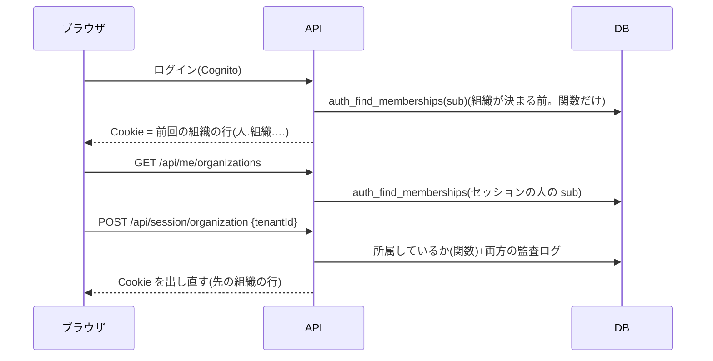

# 設計: 1人が複数の組織に入る(組織を選び直す)

> **AI 用の設計書。省略せずに網羅的に書く(正はこちら)。** 人はこれを開かず、PR の本文の「人向けのまとめ」を見る([guides/human-review.md](../guides/human-review.md))。
> 仕様: [docs/specs/0055-multi-org-membership.md](../specs/0055-multi-org-membership.md)
> 状態: 承認済み(@attumkwg 2026-10-25。会話で「全部おすすめどおり」)。実装は段ごとに別の PR
> 観点の順は [review-viewpoints.md](../review-viewpoints.md)。当てはまらない節も消さずに「該当なし(理由)」と書く。

## 0. 全体像

いまの `organizations.users` の行を「その組織への所属」とみなし、**同じ人(同じメール・同じ Cognito の sub)の行が複数の組織にあってよい**ようにする(全体で一意だったメールと sub を、組織ごとの一意に変える)。セッションの形(人.組織.期限.ログインした時刻)は変えず、組織を選び直すと、その組織の行で Cookie を出し直す。「テナントはセッションからだけ」(ADR 0001 の 2)はそのまま。

## 作業の前に読んだ物(ガイド)

- 用語集・領域の説明: `docs/domain/glossary.md`・`docs/domain/organizations/README.md`(守るルール 1・3・5・10・11)
- ADR: 0001(共有の表+RLS。「見直す合図: 所属の表を足し、組織の切り替え(トークンは1社分だけ有効)」)・0007・0009(ログインは API が Cognito を呼ぶ)・0014(代理ログイン)・0017(Cookie の形と期限)・0039(開通)・0040(招待。人を足すのは関数だけ)
- 既存のコード:
  - `apps/api/src/auth/session.ts` … Cookie は `人.組織.期限.ログインした時刻`(代理は6つ)。組織はここからだけ
  - `apps/api/src/auth/lookup.ts`・`drizzle/0001_rls.sql`・`0005_login_link.sql` … ログインの前に人を引く関数(`auth_find_user_by_email`・`auth_find_user_by_external_id`・`auth_link_external_id`)。どれも「1行」を返す前提
  - `drizzle/0009_account_security.sql` の `auth_email_in_use` … メールの変更で、全体で使われているかを見る
  - `drizzle/0014_invitations.sql` の `auth_accept_invitation` … `users_email_key`(全体で一意)で「他社の人」を止めている
  - `apps/api/src/authz/middleware.ts` … 毎回、セッションの組織でその人の行(`findAccess`)を引く。行が無ければ 401
  - `apps/api/src/offboarding/delete-tenant.ts` の `cognitoSubs`・`apps/api/src/person-data/` の `cognitoSub` … Cognito から消す人
  - `apps/api/src/onboarding/create-tenant.ts` … 2回目を `users_email_key` で止めている

## 1. 設計方針

- **所属の表を新しく作らない**: `users` の行がすでに「組織ごとの名前・ロール・同意・作った物の持ち主」を持つ。人に1つの物(パスワード・二段階認証・メール)は Cognito が正で、`users` は写し(`mfa_enabled`・`email`・`sessions_valid_after`)を持つ。写しは全部の所属の行にそろえる(下の 5)。
  - 別案(人の表 `identities` を足し、`users` を所属にする)は 11 に理由。
- 一意の付け替え: `users_email_key`(全体)→ `(tenant_id, email)`、`users_external_id_key`(全体)→ `(tenant_id, external_id)`。
- 組織が決まる前に人の所属を引くのは、今と同じく SECURITY DEFINER の関数だけ(`app_auth` が持ち主)。返すのは組織の ID と名前とロールだけ。
- 新しい依存は無い。

## 2. データモデル

移行(段階を分ける。番号は 0018 以降):

| 段 | 移行 | 中身 | 戻し方 |
|---|---|---|---|
| ① 拡張 | `0017_multi_org_expand`(索引は `concurrent/0017_multi_org_keys`) | `(tenant_id, email)`・`(tenant_id, external_id)` の一意の索引を足す(`CREATE UNIQUE INDEX CONCURRENTLY`。`drizzle/concurrent/`)。関数 `auth_find_memberships(p_external_id text, p_email text)` を足す(sub か、sub の無い行は確認済みのメールで。返すのは `user_id, tenant_id, tenant_name, role, last_used_at`) | 索引と関数を消す |
| ② 両方 | アプリ | ログイン・切り替えが新しい関数を使う。古い一意は残っているので、まだ2つ目の所属はできない | 前の版に戻す |
| ③ 縮小 | `0018_multi_org_contract`(索引は `concurrent/0018_drop_global_user_keys`) | `users_email_key`・`users_external_id_key`(全体の一意)を消す。`auth_link_external_id` を「確認済みのメールで、sub の無い行を全部」結びつける形に。`auth_accept_invitation` は一意の失敗を `(tenant_id, email)` の重なり(もうその組織にいる)だけにする。`auth_email_in_use` は「ほかの人(別の sub)が使っているか」に | **戻せない**(2つ目の所属ができた後は、全体の一意を張り直せない)→ U-3 |

足す列(① で):

| 列 | 型 | 区分 | 中身 |
|---|---|---|---|
| `organizations.users.last_used_at` | timestamptz(NULL 可) | internal | その組織に最後に入った(ログイン・切り替え)時刻。ログインで「前回の組織」を選ぶ |

- RLS・`TENANT_TABLES`・書き出しは変わらない(行は組織ごとのまま)。書き出しにほかの組織の所属は入れない。
- 列の分類表に1行。`person-data` の一覧は変わらない(新しい人の ID の列は無い)。

## 3. API

| API | 権限 | 入力 | 出力 | 失敗 | 監査ログ |
|---|---|---|---|---|---|
| `GET /api/me/organizations` | me:read(全ロール) | — | `{ organizations: [{ tenantId, name, role, current }] }`(名前の順。上限 U-4) | 401 | — |
| `POST /api/session/organization` | 新しい権限 `session:switch`(全ロール。代理の最中は使えない `NOT_DURING_SUPPORT`) | `{ tenantId }` | 200 `Me`(先の組織)+ Set-Cookie | 401・403(代理の最中)・404(所属していない) | 元の組織に `auth.switch_out`・先の組織に `auth.switch_in`(手で記録。target なし) |

- `POST /api/session/organization` は**本文に組織の ID を取る唯一の API**。組織を決めるのは、セッションの人(sub)がその組織に所属しているかを関数で確かめた結果で、ログインと同じ扱い(ADR 0066)。
- 関所の外で動く(`OUTSIDE_TRANSACTION` ではなく、ログインと同じ公開の形にはしない): 関所はいまの組織で人を確かめた後にハンドラーを呼び、ハンドラーが先の組織を関数で確かめる。
- `GET /api/me` に `organizationsCount` を足す(画面が切り替えを出すか決める)。契約は足すだけ。

## 4. 状態遷移

- 所属: 無い → ある(招待を受ける・開通・運営の SQL)→ 無い(その組織で消す・解約)。人(Cognito)は最後の所属が無くなったときだけ消す。
- セッション: 組織 A → 切り替え → 組織 B(Cookie を出し直す。ログインした時刻は引き継ぐ。U-2)。

## 5. システム間連携

- Cognito: 変えない。人は1つ(sub)。
- 写しをそろえる: パスワードの変更・二段階認証の有効・無効・メールの変更・ほかの端末を切る(`sessions_valid_after`)は、本人の**全部の所属の行**に書く。組織をまたぐ書き込みなので、関数 `auth_sync_person(p_external_id, p_email, p_mfa_enabled, p_sessions_valid_after)`(`app_auth` が持ち主・この列だけ)にする。いまの `setMfaEnabled`・`endOtherSessions`・`confirmEmailChange` が呼ぶ。
- 本人へのお知らせ(パスワードが変わった など)は、今いる組織から1通(全部の組織から送らない)。
- 解約(`delete-tenant`): `cognitoSubs` から、ほかの組織にも行がある sub を外す(関数で数える)。手順書の 3 に「ほかの組織に所属している人は Cognito から消さない」を足す。
- 1人分(`person-data`): `cognitoSub` に「ほかの所属の数」を足す(0 のときだけ Cognito から消す)。
- 開通(`create-tenant`): 2回目を止めるのは「同じ組織の名前と同じ管理者のメール」ではなく、試しの出力に「この管理者はほかの組織にも所属している(数)」を出す形に(全体の一意が無くなるため)。U-5。

## 6. 業務ルール

- ログインの後の組織: 所属のうち `last_used_at` が一番新しい組織。無ければ `created_at` が一番古い組織(U-1)。ログインと切り替えで `last_used_at` を書く。
- 切り替え:
  - 代理の最中は 403。
  - 先の組織の行が無ければ 404(他社の存在を言わない)。
  - パスワードは入れ直さない。ログインした時刻を引き継ぎ、期限(無操作1時間・最長12時間)はそのまま数える(U-2)。
  - 先の組織が二段階認証を必須にしていて未設定なら、関所が今と同じく 403 `mfa_setup_required`(画面は設定へ)。規約の同意も同じ。
- 1人の所属は 50 まで(招待を受けるとき・開通のときに数える。U-4)。
- メールの変更: 新しいメールが**ほかの人(別の sub)**に使われていれば 409(今と同じ文)。同じ人のほかの所属は一緒に変わる。
- 運営の組織(`SUPPORT_TENANT_ID`)にも所属は持てる。社員が客の組織にも所属していてよい(代理ログインとは別。代理の最中は切り替えない)。
- 画面: 切り替えたら、ルーターのキャッシュを全部捨てて読み直す(前の組織のデータを残さない)。

## 7. 要求との対応

| 受け入れ条件(仕様) | 設計のどこ | テスト(実装の PR で) |
|---|---|---|
| 複数の組織に、組織ごとのロールと名前で所属 | 1・2 | `multi-org.int.test.ts`「同じ sub の行が2つの組織に」 |
| 招待で所属が増える | 2 ③(`auth_accept_invitation`) | `invitations.int.test.ts` を「他社の人でも参加できる」に作り直す |
| 開通でほかの組織の人を管理者に | 5 | `tenant-provisioning.int.test.ts` |
| 前回の組織に入る | 6 | 「ログインは last_used_at の組織」 |
| 一覧と切り替え・Cookie は1組織分 | 3 | 「切り替えで Cookie の組織が変わる・前の組織の API は 404」 |
| 所属していない組織は 404 | 3・6 | 「他社の ID では 404」 |
| パスワードを入れ直さない・二段階認証と同意は組織ごと | 6 | 「必須の組織に切り替えると mfa_setup_required」 |
| 両方の監査ログ | 3 | 「switch_out と switch_in」 |
| 本人のアカウントは全部の所属に効く | 5 | `account-security.int.test.ts`「ほかの所属の写しもそろう」 |
| 代理の最中は切り替えない | 6 | `support-access.int.test.ts` |
| 解約・1人分で Cognito を消すのは最後の所属だけ | 5 | `offboarding.int.test.ts`・`person-data.int.test.ts` |
| 見えるのはセッションの組織だけ | 1 | `tenant-isolation.int.test.ts`(今のまま)・E2E「切り替えたら前の組織のデータが出ない」 |

## 8. 非機能

- 性能: ログインで関数1回(所属は数件)。切り替えは関数1回+監査ログ2行。関所は今のまま。
- セキュリティ: 仕様の STRIDE。本文に組織の ID を取る API が1本増える → 所属の確かめは DB の関数(sub で)。結合テストで他社の ID・消された所属・代理の最中。
- 運用: 手順書 `cognito-login.md`(結びつきを直す・所属の一覧の見方)・`offboarding.md` の 3・`person-data.md` の 5。
- 費用: なし。
- 移行: ③ は戻せない(U-3)。① と ② を出して1週間見てから ③。

## 9. このプロダクト特有

| 観点 | この変更では |
|---|---|
| テナント分離 | セッションは1組織分のまま。所属を引くのは関数だけ。切り替えは所属を確かめてから |
| 権限の表 | 2行(`me:read`・`session:switch`) |
| 監査ログ | `auth.switch_out`・`auth.switch_in`(手で。両方の組織) |
| 解約で消す一覧 | 変わらない。Cognito を消す人だけ変わる |
| サポートの代理ログイン | 代理の最中は切り替えない。社員が客の組織に所属してもよい |
| ログの個人情報 | 所属の一覧はログに出さない(ID と数だけ) |
| 列の分類(`personal` / `sensitive`) | `last_used_at`(internal)を1行 |
| 画面の部品 | ヘッダーに組織の切り替え(`Select` か新しいメニューの部品)。VRT の撮り直し |

## 10. 観点ごとの扱い

| 観点 | 扱い | 理由 |
|---|---|---|
| 設計方針 | 最重要 | ADR 0001 の「1人 = 1組織」を置き換える。所属の表を作らず users を所属にする(U-3) |
| データモデル | 最重要 | 全体の一意を外すのは戻せない(U-3) |
| API | 採用 | 本文に組織の ID を取る唯一の API(所属の確かめが要) |
| 業務ルール | 最重要 | 前回の組織・入れ直さない・上限(U-1・U-2・U-4) |
| 状態遷移 | 軽く確認 | 所属の増減と、Cognito を消す時 |
| システム間連携 | 採用 | 写しをそろえる関数・解約と1人分の Cognito |
| 要求との対応 | 採用 | テストは実装の PR で(いまは設計だけ) |
| 非機能 | 採用 | 移行の段階 |
| テナント分離 | 最重要 | 切り替えの確かめと、画面の状態を捨てること |

## 11. 決めたこと(AI が決めた。人に聞かなかった)

- **users を所属として使い、人の表は作らない** — 組織ごとの名前・ロール・同意・作った物の持ち主・監査ログの「誰が」は、もう users の ID を指している。人の表を足して users を作り直すと、全部の表の参照と RLS の前提が変わる。写し(メール・二段階認証・切った時刻)を全部の所属にそろえる関数で足りる。人に紐づく物が増えたら(個人の設定・通知の受け方)、そのとき人の表を足す。
- **セッションの形は変えない** — Cookie の「人」は users の ID(= 所属)のまま。切り替えは別の行で出し直すだけ。関所・RLS・代理ログインに手が入らない。
- **切り替えの API は本文に組織の ID を取る** — 所属しているかを DB の関数で確かめ、その結果でセッションを出し直す。ログインと同じ「資格から組織が決まる」形で、リクエストの値で組織を選ばせない決まりの例外ではない(ADR 0066 に書く)。
- **所属の一覧は本人にだけ** — 管理者・書き出し・監査ログに、ほかの組織の名前や ID を出さない。
- **お知らせは今いる組織から1通** — 同じ人に同じ知らせが組織の数だけ届かないように。
- **画面は切り替えでキャッシュを全部捨てる** — 前の組織のデータが残って見える事故を、仕組みで防ぐ。

## 12. 未確定事項(AI の仮決め。人の承認と分けて追う)

> 4つに当たる判断だけ。状態の書き方は [guides/human-review.md](../guides/human-review.md) の 2。`pnpm decisions` がここを読む。**`仮決め` が残る PR はマージしない。**

| 番号 | 工程 | 種類 | 仮決め(設計した事実) | なぜそうしたか | 人が判断する問い | 状態 |
|---|---|---|---|---|---|---|
| U-1 | 設計 | 利用者の挙動 | ログインの後は**前回使った組織**に入る(選ぶ画面を挟まない)。初めては一番古い所属 | 多くの人は所属が1つ。毎回選ばせると手間が増える。切り替えは画面の上でいつでもできる | 毎回選ぶ画面を出すか(所属が2つ以上の人だけ) | 承認(@attumkwg 2026-10-25。会話で回答) |
| U-2 | 設計 | 利用者の挙動 | 切り替えは**パスワードを入れ直さない**。ログインした時刻(最長12時間)は引き継ぐ。先の組織の二段階認証の必須と規約の同意は今と同じく効く | 同じ人の同じログイン。入れ直させると切り替えのたびに手間。必須の組織の守りは関所が今と同じに効く | 病院など、組織によっては切り替えでも入れ直させるか(組織ごとの設定にするか) | 承認(@attumkwg 2026-10-25。会話で回答) |
| U-3 | 設計 | 戻せないリスク | **全体で一意のメールと sub を外す**(組織ごとの一意に)。users を所属として使い、人の表は作らない。段階は ① 拡張 → ② 両方 → ③ 縮小で、③ は戻せない | 参照と RLS を変えずに済む一番小さい形。写しは関数でそろえる | この形でよいか(人の表を作る形にするか)。③ を出す時期 | 承認(@attumkwg 2026-10-25。会話で回答) |
| U-4 | 設計 | 事業判断 | 1人の所属は **50** まで | 一覧と切り替えを軽く保つ。医師・取引先でも数十で足りる見込み | 50 でよいか(運営の組織の社員など、もっと多い人がいるか) | 承認(@attumkwg 2026-10-25。会話で回答) |
| U-5 | 設計 | 他チームとの契約や制約 | 開通の2回目の守りは「同じ管理者のメール」では止めず、試しの出力に「この管理者はほかの組織にも所属している(数)」を出して、2人で確かめる形に変える | 全体の一意が無くなると、メールの重なりで2回目を止められない | 申込書の受け渡しで、2回流しの見落としを人の確かめで防ぐ形でよいか(申込番号を組織に持たせて止めるか) | 承認(@attumkwg 2026-10-25。会話で回答) |

## 13. 作り直しの記録

| 日付 | きっかけ | 入った工程 | 直した物 | 作り直した下流 |
|---|---|---|---|---|
