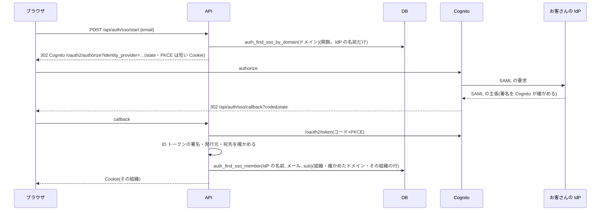

# 設計: SSO(SAML)・SCIM・組織ごとの IP の制限・強制ログアウト・監査ログの書き出し

> **AI 用の設計書。省略せずに網羅的に書く(正はこちら)。** 人はこれを開かず、PR の本文の「人向けのまとめ」を見る([guides/human-review.md](../guides/human-review.md))。
> 仕様: [docs/specs/0056-sso-scim-ip-audit-export.md](../specs/0056-sso-scim-ip-audit-export.md)
> 状態: 承認済み(@attumkwg 2026-10-25。会話で「全部おすすめどおり」)。実装は段ごとに別の PR(段1a・1b・2・3 とも済み)
> 観点の順は [review-viewpoints.md](../review-viewpoints.md)。当てはまらない節も消さずに「該当なし(理由)」と書く。

## 0. 全体像

段1 で、組織が自分のドメインを DNS で確かめ(T-8)、運営がその組織に SAML の IdP を Cognito の SAML の IdP としてつなぐ。ログインの画面はメールのドメインで IdP へ回し、戻ってきたら API が Cognito とコードを交換して、**その IdP をつないだ組織の・確かめたドメインの人**だけを入れる。同じ段で、SSO の必須と緊急用のアカウント・組織ごとの IP の制限・管理者による強制ログアウトを足す。段2 で SCIM(人を作る・止める)、段3 で監査ログの書き出し。

## 作業の前に読んだ物(ガイド)

- 用語集・領域の説明: `docs/domain/glossary.md`・`docs/domain/organizations/README.md`
- 決まり: `docs/security.md` の T-8・L-8・T-6(流量)
- ADR: 0001(テナントはセッションからだけ)・0007(トークンは API の中だけ)・0009(ログインの画面は自前・API が Cognito を呼ぶ・偽物は契約テスト)・0014(代理ログイン)・0017(Cookie だけ・サーバー側のセッションは作らない)・0031(書き出しは1ページずつ流す)・0040(人を足すのは関数だけ)・0058(プランの機能)・0066(複数の組織。提案中)
- 既存のコード:
  - `apps/api/src/auth/providers.ts` … Cognito の API を SDK ではなく HTTP で呼ぶ(`InitiateAuth` など)。OAuth の入口(ドメイン)は使っていない
  - `infra/terraform/envs/*/cognito.tf` … ユーザープールとアプリクライアント。ドメイン・OAuth・IdP は無い
  - `apps/api/src/auth/pending-mfa.ts` … ログインの途中の状態を短い暗号化の Cookie に持つ形(SSO の state と PKCE も同じ形)
  - `apps/api/src/authz/middleware.ts` … 組織が決まった後に毎回その人の行を引く。`sessions_valid_after` でそれより前のセッションを切る
  - `apps/api/src/export/stream.ts` … 1ページずつ流す書き出し
  - `packages/fake-cognito/` … 偽物の Cognito と契約テスト(SAML・OAuth の入口は無い)

## 1. 設計方針

- **SAML は Cognito に任せる**(ADR 0067): SAML の署名の確かめ・主張の読み取りを自前で書かない。API は OAuth のコードの交換と、Cognito の ID トークンの確かめだけ。トークンは API の中で使い捨て(Cookie はいまのセッションだけ。ADR 0007)。
- **組織を決めるのは IdP**: 戻ってきた人の組織は、その IdP をつないだ組織(DB の対応)で決まる。メールの文字列から組織を選ばない。メールのドメインは「その組織の確かめたドメインか」の確かめにだけ使う(T-8・L-8)。
- **人を足すのは関数だけ**(ADR 0040 のまま): SSO の初めてのログインで勝手に人を作らない(U-2)。SCIM で作るのも関数。
- **強制ログアウトはいまの仕組みで**: `users.sessions_valid_after = now()`(関所が毎回見ている)。サーバー側のセッション保存は作らない(ADR 0017 のまま)。端末を選んで切るのは、やらないこと。
- **組織ごとの設定は管理者の API、IdP のつなぎは運営のコマンド**(U-1)。
- 置き場: 領域「組織」(`domains/organizations/`)にドメイン・SSO の設定・IP の一覧・SCIM の鍵。ログインの入口は `auth/sso-routes.ts`。SCIM は `auth/scim-routes.ts`(鍵から組織が決まる入口)。
- 新しい依存: ID トークンの確かめに `jose`(もうある)。DNS は `node:dns/promises`。SAML の部品は足さない。
- **プランの機能にする**(U-6): `sso`・`scim`・`ip-allowlist`・`audit-export` を機能フラグの状態 `plan` で出す。

## 2. データモデル

新しい表(段ごとの移行。番号は 0018 以降・各段の実装の PR で。どれも `tenant_id`・RLS・`TENANT_TABLES`):

| 段 | 表 | 列 | 書く人 |
|---|---|---|---|
| 1 | `organizations.domains` | id・tenant_id・domain(小文字)・verify_token(DNS に置く文字。秘密ではない)・verified_at・created_at・created_by | 管理者(API)。確かめるのは API(DNS を引いてから) |
| 1 | `organizations.sso_connections` | id・tenant_id・provider_name(Cognito の IdP の名前)・required(必須)・created_at・updated_at | IdP は運営のコマンド。`required` は管理者(API) |
| 1 | `organizations.ip_allowlist` | id・tenant_id・cidr(`cidr` 型)・created_at・created_by | 管理者(API)。1組織 20 行まで |
| 2 | `organizations.scim_tokens` | id・tenant_id・token_hash・created_by・created_at・last_used_at・revoked_at・revoked_by | 管理者(API)。鍵はハッシュだけ |

足す列:

| 段 | 列 | 型 | 中身 |
|---|---|---|---|
| 1 | `organizations.users.sso_exempt` | boolean(既定 false) | 緊急用のアカウント(SSO 必須でもパスワードで入れる)。1組織 2人まで・管理者だけ |
| 2 | `organizations.users.disabled_at` | timestamptz(NULL 可) | SCIM で止めた時刻。関所はこの人を入れない(401) |
| 2 | `organizations.users.scim_external_id` | text(NULL 可) | 情シスの道具の側の ID(SCIM の `externalId`) |

- 一意: `organizations.domains(domain) where verified_at is not null`(確かめたドメインは全体で1つの組織だけ。RLS は一意の索引に効かないので、他社のドメインとも重ならない)。
- 組織が決まる前に引く関数(`app_auth` が持ち主・返す物を絞る):
  - `auth_find_sso_by_domain(p_domain)` → `provider_name` だけ(組織の ID は返さない)
  - `auth_find_sso_member(p_provider_name, p_email)` → その IdP の組織で、メールのドメインが確かめたドメインで、その組織にそのメールの行があるときだけ `user_id, tenant_id`。**sub では結びつけず、`external_id` も書かない**(下の 13。パスワードで先に結びついた人も同じ行に入る)
  - `auth_find_scim_token(p_hash)` → 取り消されていない鍵の ID と `tenant_id`(段2。鍵の ID は監査ログの行為者)
  - `scim_create_user(p_tenant_id, p_user_id, p_email, p_name, p_external_id)` → いまの組織の文脈の中でだけ・確かめたドメインのメールだけ(関数の中で確かめる。下の 13)・ロールは member(段2。`auth_accept_invitation` と同じ形)
  - 止めた人(`disabled_at`)は `auth_find_memberships`・`auth_find_sso_member` に出さない(段2。ログインの所属にならない)
- 列の分類表: `domains.domain` は internal(会社のドメイン。個人ではない)・`ip_allowlist.cidr` は internal・`scim_tokens.token_hash` は internal・`users.scim_external_id` は personal(情シスの道具の人の ID)。
- 書き出し(`POST /api/exports`)に、ドメインと IP の一覧は入れる(お客さんの設定)。鍵のハッシュと IdP の名前は入れない。
- `person-data` の一覧: 新しい人の ID の列(`domains.created_by`・`ip_allowlist.created_by`・`scim_tokens.created_by`・`revoked_by`)を「残す」で足す(実装の PR で。足し忘れはテストが落とす)。

## 3. API

| API | 権限 | 入力 | 出力 | 監査ログ |
|---|---|---|---|---|
| `GET /api/organization/domains` | `sso:manage`(admin) | — | ドメインの一覧(確かめたか・DNS に置く文字) | — |
| `POST /api/organization/domains` | 同上 | `{ domain }` | 201 | `domain.create` |
| `POST /api/organization/domains/{domainId}/verify` | 同上(外を待つので `OUTSIDE_TRANSACTION`) | — | 200(確かめた)/ 409(まだ見えない) | `domain.verify` |
| `DELETE /api/organization/domains/{domainId}` | 同上 | — | 204(SSO が使っていれば 409) | `domain.delete` |
| `GET/PUT /api/organization/sso` | 同上 | `{ required, exemptUserIds }` | IdP がつながっているか・必須・緊急用 | `sso.update` |
| `GET/PUT /api/organization/ip-allowlist` | `ip_allowlist:manage`(admin) | `{ cidrs: string[] }`(20 まで) | 一覧。いまの IP を含まなければ 409 | `ip_allowlist.update` |
| `POST /api/organization/users/{userId}/sign-out` | `user:sign_out`(admin) | — | 204 | `user.sign_out` |
| `POST /api/auth/sso/start` | 公開 | `{ email }` | `{ next: "redirect", url }` か `{ next: "password" }` | — |
| `GET /api/auth/sso/callback` | 公開 | `code`・`state` | 302(画面へ)。失敗はログインの画面へ(理由は言わない) | `auth.login`(details に `via: sso`) |
| `GET/POST/DELETE /api/organization/scim-tokens` | `scim:manage`(admin) | — | 作ったときだけ鍵 | `scim_token.create` / `.revoke` |
| `GET/POST /api/scim/v2/Users`・`GET/PUT/PATCH/DELETE /api/scim/v2/Users/{id}` | 公開(SCIM の鍵) | SCIM 2.0 | SCIM 2.0 | `scim.user_create` / `_update` / `_disable`(行為者は `kind: scim`) |
| `POST /api/audit-events/export` | `audit:read`(admin) | `{ from, to }`(日付・両端を含む・組織の時間帯の1日・366 日まで) | JSON Lines を古い順に流す(`application/x-ndjson`) | `audit.export`(期間は details に入れない) |

- SCIM は ALB が `/api/*` だけを API に回すので `/api/scim/v2` に置く。お客さんの道具には `https://<アプリ>/api/scim/v2` を渡す。
- 監査ログの行為者の種類に `scim` を足す(`user` / `support` / `system` / `scim`)。
- 失敗の code: `domain_not_verified`・`ip_not_allowed`(403)・`sso_required`(パスワードでのログインを断るときは `login_failed` と同じ文にするか U-7)・`allowlist_excludes_you`(409)。

## 4. 状態遷移

- ドメイン: 登録 → 確かめた(DNS に文字が見えた)→ 消した。確かめた後に DNS から消えても、確かめは外さない(年1回の点検で見直す)。
- SSO: IdP なし → つないだ(運営)→ 必須(管理者)⇄ 任意 → 外した(運営)。必須にできるのは、緊急用のアカウントが1人以上いるときだけ。
- 人(SCIM): ある → 止めた(`disabled_at`)→ また有効(`active: true`)。消した = 止めた(行は残す。U-5)。
- 鍵(SCIM): 有効 → 取り消した(戻らない)。

## 5. システム間連携

- **Cognito**(Terraform。段1 の実装の PR で。apply は人が CI で):
  - ユーザープールのドメイン(`auth.<アプリのドメイン>`。ACM は us-east-1)と、アプリクライアントの OAuth(authorization code・PKCE・スコープ `openid email`・コールバック `https://<アプリ>/api/auth/sso/callback`)。
  - アプリクライアントの `supported_identity_providers` は運営のコマンドが足すので、Terraform は `lifecycle { ignore_changes }` にする。
  - 移行のタスクの役割に、そのユーザープールの `CreateIdentityProvider`・`UpdateIdentityProvider`・`DeleteIdentityProvider`・`DescribeUserPoolClient`・`UpdateUserPoolClient` だけ。
  - 1つのユーザープールの IdP は数百まで(AWS の上限)。超えそうならプールを分ける(見直す合図)。
- **運営のコマンド** `sso-connect <組織の ID> --metadata-url <URL>`(試し → 本番): 組織に確かめたドメインがあるかを見てから、IdP(名前 `org-<組織の ID の後ろ 20 桁>`・属性の対応 `email`)を作り、アプリクライアントに足し、`sso_connections` に行。外すのは `sso-disconnect`(先に DB の行を消して止め、それから Cognito を掃除する)。メタデータの URL はお客さんの情シスから受け取る(公開の物。秘密ではない)。`UpdateUserPoolClient` は渡さなかった項目を既定に戻すので、いまの設定を読んで全部渡し直す。
- **ID トークンの確かめ**: Cognito の JWKS(`jose` の `createRemoteJWKSet`)・`iss`(プール)・`aud`(アプリクライアント)・`token_use: id`・`identities[0].providerName`。
- **DNS**: `resolveTxt("_sfs-verify." + domain)` に `sfs-verify=<verify_token>` があるか。VPC のリゾルバーで引く。待つのはトランザクションの外。
- **偽物の Cognito**(`packages/fake-cognito`): OAuth の authorize と token・JWKS・「つないだ IdP」を、テスト用に組織とメールを決めて返す形で足す。本物の SAML は stg で、テスト用の IdP(手順書に作り方)で人が確かめる(契約テストに SAML は入れない。U-8)。
- **E2E**: 偽物の IdP でログイン → その組織に入る・他社のドメインの人は入れない・必須でパスワードを断る・緊急用は入れる・IP の制限。

## 6. 業務ルール

- 組織が決まる流れ: IdP の名前 → その組織(`sso_connections`)→ メールのドメインがその組織の確かめたドメインか → その組織にそのメールの行があるか → プランの機能 `sso` が入っているか。どれか外れたら入れない(ログインの画面へ `?sso=failed`。理由は言わない。ログに `reason`)。
- SSO で入ったセッションには印(Cookie の5つ目 `sso`)を付ける。関所は、必須の組織の確かめたドメインの人(緊急用でない)を、印の無いセッションでは 403 `sso_required` にする(必須にした時より前のパスワードのセッションも止まる)。組織を切り替えると印は外れる(SSO で確かめたのは入った組織だけ)ので、必須の組織への切り替えは 403 `sso_required`(その組織の SSO で入り直す)。
- SSO で入った人には、組織の二段階認証の必須を当てない(IdP の役目。Cognito は IdP から来た人の TOTP を持てない)。
- パスワードのログインは、前回の組織の順に所属を見て、SSO が要る組織を飛ばす。全部が SSO の組織なら 403 `sso_required`。
- JIT(初めてのログインで人を作る)はしない(U-2)。
- 必須の組織で、確かめたドメインの人がパスワードでログインしたら断る。緊急用(`sso_exempt`)だけは通す。緊急用は二段階認証が必須(未設定なら設定の画面へ)。緊急用の印は、その人が管理者のときだけ効く(後でメンバーに下げたら効かない)。
- 確かめたドメイン以外のメールの人(取引先など)は、必須の組織でもパスワードで入れる(SSO の外の人)。
- IP の制限: 組織に一覧があれば、関所はセッションの組織の一覧に、いまの IP が入っているかを毎回見る(リクエストごとに1回読む)。ログインと組織の切り替え(ADR 0066)でも見る。
  - いまの IP: 設定の `CLIENT_IP_HEADER`(既定 `X-Forwarded-For`。CloudFront を前に置いたら `CloudFront-Viewer-Address`)の、右から `TRUSTED_PROXY_HOPS` 個目の値(ポートは外す)。画面のサーバー(SSR)からの呼び出しは、画面のサーバーが受け取った同じヘッダーを渡す(画面のサーバーは中の通信なので、そのヘッダーを信じてよい)。U-9。
  - ヘッダーの名前を変えるだけでは、なりすましは止まらない。ALB が CloudFront からしか受けない形(送り元のプレフィックスリストと、CloudFront だけが知る秘密のヘッダー)は設計書 0058 で。
  - 緊急用のアカウントも制限を受ける(U-3)。代理の社員は受けない(U-4。記録は今と同じく残る)。
  - いまの IP を含まない一覧は保存できない(409)。運営が外す手順は手順書に(表の持ち主で行を消す。2人で)。
- 強制ログアウト: 管理者が人を選ぶ → その人の行の `sessions_valid_after = now()`。自分自身もできる(ほかの端末を切る)。
- SCIM: 作るときのメールは確かめたドメインだけ。名前を直せる。ロールは変えない(管理者が画面で)。`active: false` で止める(`disabled_at` と `sessions_valid_after`)。DELETE は止めると同じ。行と監査ログは残す(U-5)。
- 監査ログの書き出し: `from`〜`to`(日付・両端を含む・組織の時間帯の1日・最長 366 日)を、古い順に1ページずつ JSON Lines で流す(書き出しの ADR 0031 と同じ。並びは UUIDv7 の ID の順・期間は `occurred_at` で絞る)。項目は画面の監査ログと同じ(値は入っていない)。プランの機能 `audit-export`。

## 7. 要求との対応

| 受け入れ条件(仕様) | 設計のどこ | テスト(実装の PR で) |
|---|---|---|
| ドメインを DNS で確かめる・1ドメイン1組織 | 2・3・5 | `organization-domains.int.test.ts`(DNS を差し替え)・`client-ip.test.ts`(TXT をつなぐ) |
| 運営が IdP をつなぐ | 5 | コマンドの結合テスト(Cognito を偽物に) |
| メールで IdP へ回り、戻るとその組織に | 0・3・5 | `sso-login.int.test.ts`・E2E `sso.spec.ts`(偽物の IdP) |
| その IdP の組織・確かめたドメインの人だけ | 6 | 「他社の IdP から入れない」「ドメインが違えば入れない」 |
| いない人は入れない(JIT なし) | 6・U-2 | 「行が無ければ入れない」 |
| 必須・緊急用2人・二段階認証 | 6 | 「必須でパスワードを断る」「緊急用は通る」 |
| IP の制限 20 個・締め出さない | 6 | `ip-allowlist.int.test.ts`・`client-ip.test.ts`(ヘッダーの数え方)・`multi-org.int.test.ts`(組織の選び直しも外からは 403) |
| 強制ログアウト | 6 | `organization-domains.int.test.ts` の「次のリクエストから 401」 |
| 変更が監査ログに | 3 | `audit-coverage.test.ts`(自動) |
| SCIM の鍵・Users・止める・消す=止める | 3・6 | `scim.int.test.ts`(2社) |
| SCIM の操作が監査ログに | 3 | 同上 |
| 監査ログの書き出し | 3・6 | `audit-export.int.test.ts`(他社の行が入らない) |
| 管理者だけ・他社は見えない | 3 | `authz-matrix.int.test.ts`(自動) |
| 部品のカタログ | 1 | `pnpm kit:catalog` |

## 8. 非機能

- 性能: 関所に IP の一覧の読み(組織ごとに数行)が1回増える。一覧が無い組織は索引で0件。SSO のログインは Cognito への往復が2回増える(画面の移動)。
- セキュリティ: 仕様の STRIDE。公開の入口が3つ増える(SSO の開始・戻り・SCIM)。SSO の開始はドメインが SSO かどうかだけを返す(人がいるかは言わない)。SCIM は鍵のハッシュで引き、WAF の IP ごとの上限が前にある。
- 運用: 手順書 `docs/runbooks/sso.md`(つなぐ・外す・IdP の証明書の更新・IdP が止まったとき・IP で締め出されたとき)・`scim.md`。
- 費用: Cognito の SAML の利用者は、月の利用者ごとの料金が普通の利用者より高い(段1 の前に、使う人の数で見積もる)。
- 上限: ユーザープールの IdP の数(数百)。

## 9. このプロダクト特有

| 観点 | この変更では |
|---|---|
| テナント分離 | SSO は IdP → 組織の対応で決まり、メールのドメインはその組織の確かめた物だけ。SCIM は鍵で組織が決まる。どちらもリクエストの値で組織を選ばない |
| 権限の表 | 管理者の API が十数行・公開の入口3つ(実装の PR で) |
| 監査ログ | 設定の変更・SCIM・強制ログアウト・書き出し。行為者の種類に `scim` |
| 解約で消す一覧 | 新しい表を4つ。Cognito の IdP も解約の手順書で消す |
| サポートの代理ログイン | 代理の社員は IP の制限の対象外(U-4)。設定は見るだけ |
| ログの個人情報 | SSO の失敗はログに `reason` と IdP の名前だけ(メールは出さない) |
| 列の分類(`personal` / `sensitive`) | `scim_external_id` が personal。ほかは internal |
| 画面の部品 | 設定に「ドメイン」「SSO」「IP の制限」「SCIM」の欄・ログインの画面に「会社のアカウントでログイン」の段 |

## 10. 観点ごとの扱い

| 観点 | 扱い | 理由 |
|---|---|---|
| 設計方針 | 最重要 | SAML は Cognito に任せる(ADR 0067)。組織を決めるのは IdP |
| テナント分離 | 最重要 | 公開の入口が3つ増える。他社の IdP・確かめていないドメイン |
| 業務ルール | 最重要 | JIT・緊急用・IP の対象・SCIM の削除(U-2〜U-5) |
| データモデル | 採用 | 表4つ・列3つ。確かめたドメインの全体の一意 |
| システム間連携 | 最重要 | Cognito の OAuth・IdP・Terraform・偽物の Cognito |
| API | 採用 | SCIM 2.0 の形 |
| 非機能 | 採用 | Cognito の料金と上限・IP の取り方 |
| 要求との対応 | 採用 | テストは各段の実装の PR で |

## 11. 決めたこと(AI が決めた。人に聞かなかった)

- **SAML は Cognito の SAML の IdP**(自前で SAML を読まない) — 署名・時刻・宛先の確かめを自前で書くと、穴になりやすい。Cognito はもう使っている(ADR 0007)。
- **組織を決めるのは IdP、ドメインは確かめにだけ** — メールの文字列で組織を選ぶと、他社の IdP が任意のメールを名乗れる(L-8)。
- **強制ログアウトは `sessions_valid_after`** — 関所がもう毎回見ている。サーバー側のセッション保存(ADR 0017 の B)を作らずに、仕様の「その人の全部の端末」を満たせる。
- **SCIM は `/api/scim/v2`** — ALB が `/api/*` だけを API に回すため。
- **IP の取り方は「右から決まった数」** — 左端の値は呼ぶ側が好きに書ける。
- **ドメインを DNS から消しても確かめは外さない** — 一時的な DNS の変更で SSO が止まるのを避ける。年1回の点検で見直す(点検の台帳に足す)。
- **監査ログの書き出しはデータの書き出しと同じ流し方** — 大きな組織でもメモリが一定(ADR 0031)。
- **SCIM が扱えるのは、その組織の確かめたドメインのメールの人だけ**(段2) — 取引先など SSO の外の人は、情シスの道具の管理の外。道具の一覧から消えても止めない(道具が「知らない人を全部止める」動きをしても巻き込まない)。ほかの人を指すと 404。
- **SCIM には組織の IP の範囲を当てない**(段2) — 道具は自分の会社の外(Entra ID・Okta の雲)から呼ぶ。鍵(ハッシュだけ・2つまで・取り消せる)と WAF の IP ごとの上限で守る。
- **SCIM の鍵は `sfs_scim_` + 32 バイトの乱数**(段2)。頭で漏れたときに検査の道具が見分けられる。生きている鍵は2つまで(入れ替えのときに新旧を並べる)。使った時刻を毎回書く(管理者が「使われているか」を見る)。
- **SCIM の一覧は startIndex と count**(段2) — SCIM の決まりが位置で数える形なので、キットの「続きの印」のページングの例外。1ページ 100 人まで。絞り込みは道具が使う `userName eq`・`externalId eq` だけ(ほかは 400 invalidFilter)。
- **SCIM で知らない項目は聞き流し、メールの変更は 400 mutability**(段2) — 道具は扱わない項目(title・住所など)もまとめて送るので、断ると連携が止まる。メールはログインの鍵(Cognito)と結びついているので、変えるのは本人の画面から。
- **SCIM の DELETE の後も、その人は SCIM から見える**(止めた人として。段2) — U-5 で行を残すため。RFC は「消した後は 404」を勧めるが、Entra ID・Okta はふだん PATCH の active で止めるので困らない。
- **監査ログの名前に `scim.user_enable` を足した**(段2) — 止めた人を戻すのは、止めると同じ重さの出来事なので、名前で分ける(details に値を入れない決まりのまま)。
- **SCIM の入口は CSRF の守りの外**(段2) — Cookie を使わず鍵だけで決まるので、よそのサイトのフォームの心配が無い。道具は Origin を付けず、本文の無い DELETE も送る。

## 12. 未確定事項(AI の仮決め。人の承認と分けて追う)

> 4つに当たる判断だけ。状態の書き方は [guides/human-review.md](../guides/human-review.md) の 2。`pnpm decisions` がここを読む。**`仮決め` が残る PR はマージしない。**

| 番号 | 工程 | 種類 | 仮決め(設計した事実) | なぜそうしたか | 人が判断する問い | 状態 |
|---|---|---|---|---|---|---|
| U-1 | 設計 | 他チームとの契約や制約 | IdP をつなぐのは**運営のコマンド**(お客さんの管理者の画面からではない)。メタデータの URL をお客さんの情シスから受け取る | Cognito の IdP を作る権限をアプリに渡さない(移行のタスクの役割だけ)。つなぐ時は情シスとの打ち合わせが要る | 運営がつなぐ形でよいか(お客さんが画面でつなぐ形にするか) | 承認(@attumkwg 2026-10-25。会話で回答) |
| U-2 | 設計 | 利用者の挙動 | SSO の初めてのログインで**人を作らない**(JIT しない)。招待か SCIM で先に作る | 「IdP にいれば誰でも入れる」は、プランの人数・ロールの決め方と合わない。SCIM があれば情シスの道具で作れる | 確かめたドメインの人は、初めてのログインでメンバーとして作るか | 承認(@attumkwg 2026-10-25。会話で回答) |
| U-3 | 設計 | 戻せないリスク | 緊急用のアカウントは **2人まで・管理者だけ・二段階認証が必須**。SSO 必須でもパスワードで入れる。IP の制限は受ける | IdP が止まったときに誰も入れないのを避ける。数を絞り、記録を残す | 人数と、IP の制限を受けるか | 承認(@attumkwg 2026-10-25。会話で回答) |
| U-4 | 設計 | 他チームとの契約や制約 | 代理ログインの社員は、お客さんの **IP の制限を受けない**(運営の場所から入る。入った・見たは今と同じく監査ログに残る) | 制限を受けると、問い合わせに答えられない。お客さんの許可(サポートへの許可)が要るのは今のまま | お客さんとの契約で、社員も IP の制限を受ける形にするか | 承認(@attumkwg 2026-10-25。会話で回答) |
| U-5 | 設計 | 戻せないリスク | SCIM の DELETE は**止めるだけ**(行・名前・メール・監査ログは残す)。消すのは 1人分の削除の手順(G-06) | 人の行はほかの行が指している。情シスの道具の「消す」は多くが「止める」の意味 | この扱いでよいか | 承認(@attumkwg 2026-10-25。会話で回答) |
| U-6 | 設計 | 事業判断 | SSO・SCIM・IP の制限・監査ログの書き出しは**プランの機能**(機能フラグの状態 `plan`)。キットの既定のプランには入れない | 大きなお客さん向けの上のプランの機能にすることが多い(費用も Cognito の SAML の利用者は高い) | プランの機能にするか(全部の組織で使えるようにするか) | 承認(@attumkwg 2026-10-25。会話で回答) |
| U-7 | 設計 | 利用者の挙動 | SSO 必須の組織の人がパスワードでログインしたら、「この組織は会社のアカウントでログインしてください」と**言う**(`sso_required`) | パスワードが合った後に言うので、人がいるかの手がかりにならない。言わないと問い合わせが増える | 言うか(「メールアドレスかパスワードが正しくありません」と同じ文にするか) | 承認(@attumkwg 2026-10-25。会話で回答) |
| U-9 | 設計 | 他チームとの契約や制約 | **アプリの前に CloudFront を置くのをキットの既定にする**(Terraform は別の PR。設計書 0058・ADR 0070)。いまの人の IP は、**どのヘッダーを信じるか(`CLIENT_IP_HEADER`)と何段か(`TRUSTED_PROXY_HOPS`)を設定で変えられる**ようにする(既定は ALB の `X-Forwarded-For` を右から1つ目)。なりすましは、ALB を CloudFront からしか受けない形(送り元の一覧と、名前も値も秘密のヘッダー)で止める | 持ち主の言葉「CloudFront から送る必要はあり、IP はヘッダーに送られる。それだと攻撃者に丸見えなので、ヘッダーの名前などは変える必要がある」。名前を変えるだけでは足りないので、秘密のヘッダーと送り元の一覧と組にする | CloudFront を前に置く形でよいか・秘密のヘッダーで満たすか | 承認(@attumkwg 2026-10-25。会話で回答) |
| U-8 | 設計 | 他チームとの契約や制約 | 本物の SAML は stg で、テスト用の IdP を使って人が確かめる(契約テストに入れない)。偽物の Cognito は OAuth と「つないだ IdP」を真似る | 本物の IdP を CI で立てると重い。Cognito の SAML の動きは AWS の契約 | stg に置くテスト用の IdP を何にするか(お客さんと同じ製品か) | 承認(@attumkwg 2026-10-25。会話で回答) |
| U-10 | 設計 | 事業判断 | SCIM で**止めた人は、プランの人数(`seats` と比べる数)に数えない**(段2。`seatUsage` が `disabled_at` の人を外す) | 情シスの道具は辞めた人を消さずに止めることが多い。数えると、辞めた人の分まで上限に当たる(人数の上限は止めず、運営の `plan-report` の「超えた組織」に出るだけ) | 止めた人を人数に数えるか(数えない=辞めた人の分は払わない) | 承認(@attumkwg 2026-10-26。会話で「数えない」) |

## 13. 作り直しの記録

| 日付 | きっかけ | 入った工程 | 直した物 | 作り直した下流 |
|---|---|---|---|---|
| 2026-10-26 | 段1b の実装で、Cognito は IdP から来た人を**別の人(別の sub)**として作ると確かめた。sub で結びつけると、パスワードで先に結びついた人が SSO で入れない | 設計(2・6) | `auth_find_sso_member` から sub を外し、その組織の確かめたドメインのメールの行に入れる(`external_id` は書かない)。組織を決めるのは IdP のまま | 移行 0021・`sso.ts`・結合テスト `sso-login.int.test.ts` |
| 2026-10-26 | 段1b の実装で、UUID v7 の頭 8 桁は時刻なので、近い時刻に作った組織の IdP の名前が重なると分かった | 設計(5) | IdP の名前を `org-<組織の ID の後ろ 20 桁>` に | `src/sso/connect.ts` |
| 2026-10-26 | 段1b の実装で、SSO で入った人と組織の切り替え・二段階認証の必須の扱いが設計に無かった | 設計(6) | セッションの SSO の印・関所の `sso_required`・切り替えで外れる・SSO の人に二段階認証の必須を当てない、を足した | `session.ts`・`middleware.ts`・`organization-routes.ts` |
| 2026-10-26 | 段2 の実装で、`scim_create_user` のドメインの確かめを行の方針(INSERT の WITH CHECK)に置くと、組織の文脈の中では `tenant_isolation` の許しと「または」になって効かないとテストで分かった | 設計(2) | ドメインの確かめを関数の中に移した(確かめたドメインでなければ check_violation)。行の方針は足さない | 移行 0022・`scim.ts`・`scim.int.test.ts` |
| 2026-10-26 | 段2 の実装で、監査ログの行為者の種類の制約を広げるとき、同じトランザクションで VALIDATE すると大きな表の読みが止まると分かった | 設計(2) | 制約は NOT VALID で足し直すだけにし、VALIDATE は次の移行で1文だけ流す(今ある行は全部 3つのどれか) | 移行 0022 |
| 2026-10-26 | 段3 の実装で、監査ログの名前は「書き込みの API(GET 以外)」だけに付く決まり(関所が自動で残す・単体テストが網羅を見る)で、GET の書き出しは記録の仕組みに乗らないと分かった | 設計(3) | `POST /api/audit-events/export`(本文に `from`・`to` の日付)にした。データの書き出し(`POST /api/exports`)と同じ形で、CSRF の守り・関所の監査ログ・画面のダウンロードの部品がそのまま使える。期間は1年ではなく 366 日(うるう年) | 仕様の権限の表・`audit-routes.ts`・`audit-export.int.test.ts` |
