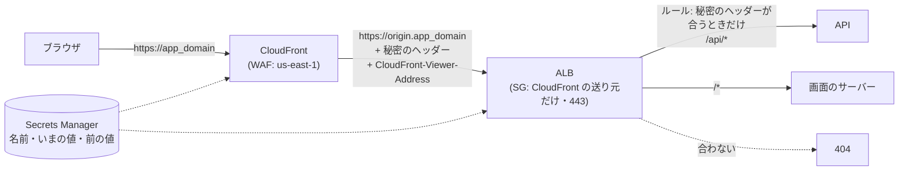

# 設計: アプリ(画面と API)の前に CloudFront を置き、ALB は CloudFront からだけ受ける

> **AI 用の設計書。省略せずに網羅的に書く(正はこちら)。** 人はこれを開かず、PR の本文の「人向けのまとめ」を見る([guides/human-review.md](../guides/human-review.md))。
> 仕様: [docs/specs/0058-cloudfront-in-front-of-app.md](../specs/0058-cloudfront-in-front-of-app.md)・ADR: [0070](../adr/0070-cloudfront-in-front-of-alb.md)
> 状態: 承認済み(承認した人: @attumkwg 2026-10-25。会話で。U-1)
> 観点の順は [review-viewpoints.md](../review-viewpoints.md)。当てはまらない節も消さずに「該当なし(理由)」と書く。

## 0. 全体像



- `app_domain` の A/AAAA は CloudFront へ。ALB には `origin.<app_domain>`(A。ALB の証明書に別名で足す)で向かう。
- CloudFront はキャッシュしない(`Managed-CachingDisabled`)。Cookie・クエリ・ヘッダーは全部渡し、`CloudFront-Viewer-Address`(いまの人の「IP:ポート」)を足す。
- ALB の入口のセキュリティグループは、CloudFront の送り元のプレフィックスリストだけ(443)。ALB のルール(API の `/api/*`・画面の `/*`)に「秘密のヘッダーが、いまの値か前の値」の条件を足す。合わなければ既定の 404。
- WAF は CloudFront の前(スコープ `CLOUDFRONT`・us-east-1)へ移す。ルールは今のまま。
- 変数 `app_cloudfront`(既定 `true`)を `false` にすると、前の形(ALB をインターネットに・WAF は ALB・`app_domain` は ALB)に戻る。

## 作業の前に読んだ物(ガイド)

- `infra/terraform/modules/ecs-service`(ALB・セキュリティグループ・API のルール)・`web-service`(画面のルール)・`waf`・`public-site`(CloudFront と us-east-1 の証明書の型)・`uptime`(us-east-1 のアラームと SNS)
- `infra/terraform/envs/stg`・`prod` の `main.tf`・`versions.tf`(Component ごとの provider)
- 設計書 0056 の 6 と U-9・`apps/api/src/http/client-ip.ts`(`CLIENT_IP_HEADER`・`TRUSTED_PROXY_HOPS`)・`docs/runbooks/sso.md` の 2
- `.github/workflows/terraform.yml`(fmt・validate・tflint・Trivy)・`terraform-plan.yml`(plan は PR に出る → 秘密は sensitive)

## 1. 設計方針

- **新しいモジュール `modules/app-front`** に CloudFront・us-east-1 の証明書・DNS・秘密(Secrets Manager)をまとめる。ALB と WAF のモジュールは「CloudFront からだけ」「スコープ」の切り替えを足すだけ(前の形も残す)。
- **秘密は名前も値もランダム**(`x-origin-<12 文字>`・48 文字)。Terraform が最初の値を作り、その後は人が Secrets Manager で入れ替える(`ignore_changes`)。Terraform はいまの値を読んで CloudFront と ALB に入れる(plan では sensitive)。
- **入れ替えで止めない**: ALB は「いまの値」と「前の値」の両方を通す。CloudFront は「いまの値」を送る。
- 新しい依存(SDK・Actions)は無い。AWS の資源の種類は CloudFront・ACM・Route 53・Secrets Manager・WAF(どれも台帳にある)と、オリジンへのリクエストの決まり(CloudFront の一部)。

## 2. データモデル

DB は触らない。

Secrets Manager の秘密 `<name>/cloudfront-origin`(KMS はアプリの鍵):

```json
{ "name": "x-origin-1a2b3c4d5e6f", "current": "<48 文字>", "previous": "" }
```

- `name`: ALB が見るヘッダーの名前(40 文字まで・英小文字と数字と `-`)
- `current`: CloudFront が送る値。ALB も通す
- `previous`: 入れ替えの間だけ。ALB は通す(空なら使わない)

## 3. API

該当なし(API を足さない)。アプリの設定だけ: API と画面のサーバーの環境変数 `CLIENT_IP_HEADER=cloudfront-viewer-address`・`TRUSTED_PROXY_HOPS=1`(`app_cloudfront = false` なら入れない = 既定の `x-forwarded-for`・1)。

## 4. 状態遷移

秘密の入れ替え(`docs/runbooks/cloudfront-origin.md`):

```
current=A, previous=""  ─人が─→ current=B, previous=A ─apply─→ (CloudFront は B・ALB は A と B)
                         ─しばらく後に人が─→ current=B, previous="" ─apply─→ (ALB は B だけ)
```

切り替え(`app_cloudfront`): false → true の apply で、ALB の証明書に別名が増え(作り直し)、`app_domain` の向き先が CloudFront に、ALB の入口が CloudFront だけに、WAF が CloudFront の前に変わる。DNS の切り替わりの間(数分)は、古い向き先(ALB に直接)の人が 404 か接続の失敗になりうる → 手順書で人の少ない時間に。

## 5. システム間連携

- **CloudFront**: オリジンは `origin.<app_domain>`(HTTPS だけ・TLS 1.2)。読み込みの待ち 60 秒(ALB の待ちと同じ。書き出しの流し出しは途中で切れない)。ビューアーは HTTP → HTTPS に転送・TLS 1.2(`TLSv1.2_2021`)・HTTP/2 と HTTP/3・IPv6。料金の区分は `PriceClass_200`(日本を含む)。アクセスログは取らない。
- **オリジンへのリクエストの決まり**(自前): Cookie 全部・クエリ全部・ヘッダーは全部+`CloudFront-Viewer-Address`。Host もそのまま(ALB の証明書は `app_domain` と `origin.<app_domain>` の両方を持つ)。
- **ALB**: 入口のセキュリティグループ = プレフィックスリスト `com.amazonaws.global.cloudfront.origin-facing`(443)。リスナーのルールに `http_header` の条件(名前・値は2つまで)。ECS の blue/green が書き換えるのは `action` だけ(`condition` は Terraform のまま)。
- **WAF**: スコープ `CLOUDFRONT` で us-east-1 に。ログ(`aws-waf-logs-*`)も us-east-1(KMS はアプリの鍵が東京なので AWS の既定の暗号化)。アラームは us-east-1 の SNS(外形監視の `uptime` の topic)。この topic は `alerts` の `extra_topic_arns` で、東京の topic と同じ Slack(Amazon Q Developer in chat applications。旧 AWS Chatbot)に流れる(メールも)。WAF と外形監視の知らせが、ほかのアラームと同じ所に届く。
- **Route 53**: `app_domain` の A/AAAA → CloudFront・`origin.<app_domain>` の A → ALB・証明書の確かめ(us-east-1 の証明書と東京の証明書は同じ確かめのレコードなので、上書きを許す)。

## 6. 業務ルール

- **R-1**: ALB は、秘密のヘッダーが「いまの値」か「前の値」のときだけ、API と画面に回す。ほかは 404(ALB の既定の応答)。
- **R-2**: いまの人の IP は `CLIENT_IP_HEADER` の右から `TRUSTED_PROXY_HOPS` 個目(仕様 0056 のまま)。CloudFront の前の形では `cloudfront-viewer-address`・1。
- **R-3**: 秘密の値・名前は plan・ログ・PR・Issue に書かない。読めるのは Terraform を流す役割と、Secrets Manager を見られる人だけ。
- **R-4**: 秘密は年に1回と、漏れた疑いのときに入れ替える(手順書)。
- **R-5**: キャッシュしない(アプリの応答は人ごと)。

## 7. 要求との対応

| 受け入れ条件(仕様) | 設計のどこ | テスト |
|---|---|---|
| app_domain は CloudFront へ・キャッシュしない・全部渡す | 0・5 | `terraform validate`(stg・prod)・手順書の確かめ(stg で画面と API が開く) |
| ALB は CloudFront の送り元だけ・80 を開けない | 5 | `terraform validate`・Trivy(0.0.0.0/0 の入口が無い)・手順書の確かめ(ALB に直接 → つながらない) |
| 秘密のヘッダーが無ければ 404 | 5・6 R-1 | 手順書の確かめ(CloudFront を通らずに `origin.<app_domain>` へ → 404。送り元の一覧の外なので、まずつながらない) |
| 秘密は Secrets Manager・入れ替えで止めない | 2・4 | 手順書(stg で入れ替えを1回) |
| いまの人の IP は CloudFront-Viewer-Address | 3・6 R-2 | `client-ip.test.ts`(「IP:ポート」)・`ip-allowlist.int.test.ts`(CLIENT_IP_HEADER を変える)・手順書(設定の画面の「いまの IP」) |
| WAF は CloudFront の前・本当の IP で数える | 5 | `terraform validate`・手順書(WAF のサンプルのリクエストに本当の IP) |
| 変数1つで前の形に戻せる | 0・4 | `terraform validate`(どちらの値でも) |
| 秘密が plan・ログ・PR に出ない | 1・6 R-3 | 変数と出力を sensitive(plan は `(sensitive value)`) |

## 8. 非機能

- 性能: CloudFront の端で TLS を終える(日本の利用者は近くの端)。キャッシュしないので、ALB までの往復は増える(数 ms〜十数 ms)。
- 費用(東京・2026-10 時点の定価の目安。公式の料金表で確かめる): CloudFront は無料枠(月 1TB・1,000万リクエスト)の中なら 0 円。超えたら日本への転送 1GB 約 $0.114・HTTPS 1万リクエスト 約 $0.012。WAF は場所が変わるだけで同じ(月 約1,500〜2,000円)。Secrets Manager 月 $0.40。証明書は無料。
- セキュリティ: 仕様の STRIDE。ALB に 0.0.0.0/0 の入口が無くなる(Trivy の除外も減る)。
- 運用: 手順書 `docs/runbooks/cloudfront-origin.md`(切り替え・確かめ・秘密の入れ替え・戻し方)。`sso.md` の 2 の表。
- 移行: Terraform だけ。DB の移行は無い。

## 9. このプロダクト特有

| 観点 | この変更では |
|---|---|
| テナント分離 | 該当なし(テナントの決め方は今のまま。セッションから) |
| 組織ごとの IP の制限 | いまの人の IP のヘッダーを、偽れない物にする(この変更の目的) |
| サポートの代理ログイン | 該当なし |
| 監査ログ | 該当なし(アプリの記録は今のまま。秘密を読む・変えるは CloudTrail) |
| 画面の部品 | 該当なし |
| 費用 | 8 のとおり。`docs/cost/estimates.yaml` の `infra`(本番+stg)の中に入る(無料枠の中なら増えない。WAF は場所が変わるだけ)。行は足さない |

## 10. 観点ごとの扱い

| 観点 | 扱い | 理由 |
|---|---|---|
| 設計方針 | 採用 | 持ち主が決めた形(U-1)。VPC オリジンは見直す合図まで先に送る |
| データモデル | 低優先 | DB を触らない |
| API | 低優先 | 足さない |
| セキュリティ | 最重要 | 入口のセキュリティグループ・秘密のヘッダー・WAF の場所。どれも危険度「高」(infra) |
| 外との連携 | 採用 | CloudFront・WAF(us-east-1)・Route 53・Secrets Manager |
| 業務ルール | 採用 | 入れ替えで止めない(値を2つ通す) |
| 非機能 | 採用 | 費用は無料枠の中が多い。超えたら転送量 |
| 運用 | 最重要 | 切り替えの時間・確かめ・入れ替えの手順を人が流す |

## 11. 決めたこと(AI が決めた。人に聞かなかった)

- **WAF を CloudFront の前へ移す**(ALB に残さない) — ALB の前に残すと、IP ごとの上限が CloudFront の IP で数えられ、関係の無い人まで止まる。`X-Forwarded-For` で数える設定は先頭の値を見るので偽れる。場所が変わるだけで費用は同じ。
- **キャッシュしない** — アプリの応答は人ごと。静的なファイルのキャッシュは速さの改善として後で(仕様の「やらないこと」)。
- **オリジンは `origin.<app_domain>`** — CloudFront は証明書の名前でオリジンを確かめる。ALB の DNS 名では証明書が合わない。名前は公開の DNS に出るが、送り元の一覧と秘密のヘッダーで守る。
- **秘密は Terraform が最初の値を作り、入れ替えは人** — 最初から人に作らせると、1回目の apply が通らない。入れ替えは `ignore_changes` で Terraform に戻されない。
- **読み込みの待ち 60 秒** — 書き出し(流し出し)と ALB の待ちに合わせる(CloudFront の既定は 30 秒)。
- **プレビュー環境は今のまま** — 1 PR ごとの環境に CloudFront を足すと、作るのに 5〜10 分かかり、費用も増える。IP の制限は既定の `x-forwarded-for` で確かめられる。
- **アクセスログは取らない** — IP を新しく残さない(公開の LP と同じ)。WAF のログ(30日)とアプリのログで足りる。

## 12. 未確定事項(AI の仮決め。人の承認と分けて追う)

> 4つに当たる判断だけ。状態の書き方は [guides/human-review.md](../guides/human-review.md) の 2。`pnpm decisions` がここを読む。**`仮決め` が残る PR はマージしない。**

| 番号 | 工程 | 種類 | 仮決め(設計した事実) | なぜそうしたか | 人が判断する問い | 状態 |
|---|---|---|---|---|---|---|
| U-2 | 設計 | 戻せないリスク | 秘密のヘッダーの値は、Secrets Manager のほかに **Terraform の state**(非公開の S3・暗号化)にも入る(CloudFront と ALB のルールに入れるため) | state を見られる人は秘密も見られる。値を入れない形(Lambda@Edge で後から付けるなど)は重い | state に秘密が入ることを受け入れるか | 承認(@attumkwg 2026-10-25。会話で回答) |
| U-3 | 設計 | 利用者の挙動 | 既に動いている環境を切り替える日時は、**使い始めた人が決める**(人の少ない時間。stg → 1週間 → prod。手順書 cloudfront-origin.md の 1) | DNS の向き先が変わる数分は、古い向き先の人が 404 か接続の失敗になりうる。いつが空いているかはプロダクトごとに違う | いつ切り替えるか | 導入時に決める(キットの既定は @attumkwg 2026-10-25 に承認。会話で回答) |
| U-1 | 設計 | 他チームとの契約や制約 | **アプリの前に CloudFront を置くのをキットの既定にする**(`app_cloudfront = true`)。ALB は送り元の一覧と、名前も値も秘密のヘッダーで CloudFront からだけ受ける。信じる IP のヘッダーと段数は設定 | 持ち主の言葉「IP がヘッダーで送られるのは攻撃者に丸見え。ヘッダーの名前なども変える必要がある」。名前を変えるだけでは足りないので、秘密のヘッダーと送り元の一覧の組にする | CloudFront を前に置く形でよいか・秘密のヘッダーで満たすか | 承認(@attumkwg 2026-10-25。会話で回答。設計書 0056 の U-9 と同じ) |

## 13. 作り直しの記録

| 日付 | きっかけ | 入った工程 | 直した物 | 作り直した下流 |
|---|---|---|---|---|
| 2026-10-25 | 持ち主の指摘「WAF のアラームも SNS から Slack に」(#100) | 設計(5 に「メールで届く」と書いた。us-east-1 の外形監視の topic が、`alerts` の `extra_topic_arns` で既に Slack に流れているのを見落とした) | 5 の WAF の知らせの先 | Terraform のコメント(envs の waf_front)・手順書 alarms.md・PR の表の 3。Terraform の形は変わらない(既に Slack に流れる) |
