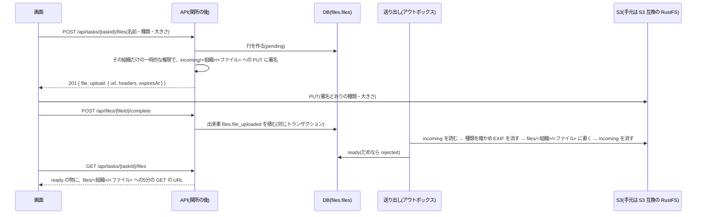

# 設計: 写真・ファイルの保存

> **AI 用の設計書。省略せずに網羅的に書く(正はこちら)。** 人はこれを開かず、PR の本文の「人向けのまとめ」を見る([guides/human-review.md](../guides/human-review.md))。
> 仕様: [docs/specs/0072-file-storage.md](../specs/0072-file-storage.md)
> 状態: 承認済み(承認した人: @attumkwg 2026-10-27。会話で「ADR は基本おすすめで良い」「キットである前提で」。U-1〜U-6 は導入時に決める)
> 観点の順は [review-viewpoints.md](../review-viewpoints.md)。当てはまらない節も消さずに「該当なし(理由)」と書く。

## 0. 全体像

タスクに写真・PDF を付ける部品を足す。中身は非公開の S3(手元は S3 互換の RustFS)に、**キーの頭を `<段>/<組織の ID>/`** にして置く。上げる・見るは、認可の関所を通った API が作る**5分の署名つき URL**で、画面と S3 が直接やりとりする。署名には**その組織のキーの頭だけに絞った一時的な権限**(STS)を使う。上げた物は API が後で読み直し、種類を確かめて位置情報などを消してから、見られる状態にする。



## 作業の前に読んだ物(ガイド)

- 穴 G-45(`docs/scenarios/gaps.md`)・`docs/scenarios/09-adoption.md` の 9-3・`06-security-audit.md` の 6-5・`companies.md`(A 社: 写真に人・表札が写りうる。要配慮は扱わない)
- `docs/security.md` の T-1・**T-4(S3 はテナントごとの置き場所+テナントで絞った一時的な権限)**・T-9・L-4(他社のファイルの URL を推測できる・期限の長い署名つき URL)・L-5(裏の処理がテナントの文脈を持たない)
- `apps/api/CLAUDE.md`(関所が開くトランザクションの中で外を待たない・ログは許可リスト・2社のテスト)
- `apps/api/src/authz/policy.ts`・`middleware.ts`: `OUTSIDE_TRANSACTION` の権限は、関所が許可の確認だけを短いトランザクションで済ませ、ハンドラーは自分で `withTenant` を開く(`domain:verify` が DNS を待つのと同じ型)。監査ログは関所が後で残す
- `apps/api/src/outbox/`(ADR 0006): 出来事は ID だけ。受け手は2回届いても大丈夫に書く。送り出しは API のプロセスの中で1秒ごと
- `apps/api/src/onboarding/application-source.ts`: S3 を読む既存の型(キーの形を正規表現で確かめる・失敗の文にキーだけ)
- `apps/api/src/offboarding/delete-tenant.ts`(`TENANT_TABLES`・Cognito を DB より先に消す順)・`docs/runbooks/offboarding.md`・ADR 0015
- `apps/api/src/export/stream.ts`(ADR 0031: 領域ごとのページの関数を並べる)・`apps/api/src/person-data`
- `infra/terraform/modules/record-store`(非公開の S3 の型: 公開を止める・TLS だけ・KMS・版・ライフサイクル)・`modules/sensitive-data`
- `docs/guides/local-environment.md`(「ファイルは S3 互換」と決めてある。表の「S3 の代わりは MinIO」は、MinIO が公式のイメージの配布をやめたので RustFS に置き換える。11)・`packages/fake-cognito`(本番では入口を変えられないようにする型)
- `docs/guides/data-retention.md`(置き場所ごとの残る期間の表)・`docs/db/personal-data.md`

## 1. 設計方針

- **新しい領域 `files`**(Postgres のスキーマ `files`。`.claude/skills/add-domain`)。使ってよい向きは `files: ["organizations", "tasks"]`(タスクへの外部キー)。タスクの領域は `files` を知らない(消すときは DB の外部キーと引き金で済ませる。2.)。
- **置き場の部品は `apps/api/src/storage/`**(領域の外の共通の部品。S3 を話すのはここだけ)。
  - `keys.ts`: **キーを作る関数は `objectKey(stage, tenantId, fileId)` の1つだけ**。`stage` は `incoming` か `files`、ID は UUID の形を確かめる(違えば投げる)。利用者の値(名前)はキーに入れない。
  - `tenant-credentials.ts`: 組織ごとの一時的な権限。本番・stg は STS の AssumeRole に**セッションのポリシー**(`incoming/<組織>/*`・`files/<組織>/*` だけ)を付けて取り、組織ごとに期限の10分前まで覚えておく。手元・テストは固定の資格情報(RustFS)。
  - `object-store.ts`: `ObjectStore`(`presignPut`・`presignGet`・`get`・`put`・`delete`・`deletePrefixAllVersions`・`countPrefix`)。どれも `tenantId` を受け、その組織の権限で S3 を呼ぶ。キーは `keys.ts` からだけ。
  - `strip-metadata.ts`: 写真の付いた情報を消す(依存を足さない。ADR 0080)。
- **API は S3 の SDK を直接呼ばない**(`@aws-sdk/client-s3` は既に入っている。署名に `@aws-sdk/s3-request-presigner` を足す。`@aws-sdk/client-sts` も足す)。
- **署名(URL を作る)は関所のトランザクションの外**で行う。STS を待つことがあるので、権限 `file:read`・`file:write` は `OUTSIDE_TRANSACTION`。ハンドラーは「DB を読む・書く(自分で `withTenant`)→ 閉じてから署名」の順。消す(`file:delete`)は S3 を呼ばない(2. の引き金と送り出し)のでトランザクションの中。
- 中身を読み直して書き直すのは**送り出し(アウトボックス)の受け手**(ADR 0080)。リクエストの中で 20MB を読まない。
- 決まり: ADR 0079(署名つき URL・キーの頭・絞った権限)・ADR 0080(上げた物はそのまま見せない)。

## 2. データモデル

表 `files.files`(移行は `.claude/skills/db-migration`。新しい表なので拡張の段だけ):

| 列 | 型 | 中身 | 分類 |
|---|---|---|---|
| `id` | uuid | ファイルの ID(キーにも使う) | internal |
| `tenant_id` | uuid not null → `organizations.tenants` | 組織 | internal |
| `task_id` | uuid not null | 付け先のタスク。`task_id` → `tasks.tasks(id)` on delete cascade(tasks に `(tenant_id, id)` の一意が無い。11) | internal |
| `uploaded_by` | uuid not null | 上げた人(`organizations.users` の ID。人が抜けても消さない・外部キーは張らない。タスクの作り手と同じ扱い) | internal |
| `name` | text not null(1〜200字) | 元の名前(表示と保存の名前)。**キー・URL・ログには入れない** | personal(施主の名前などが入りうる) |
| `content_type` | text not null | `image/jpeg`・`image/png`・`image/webp`・`application/pdf` のどれか(check) | internal |
| `byte_size` | bigint not null(1〜20MB。check) | 上げると言った大きさ(署名に入れる) | internal |
| `stored_byte_size` | bigint null | 書き直した後の大きさ | internal |
| `status` | text not null default `pending` | `pending`・`ready`・`rejected`(check) | internal |
| `created_at` | timestamptz | 作った時刻(一覧の並び) | internal |
| `ready_at` | timestamptz null | 見られるようになった時刻 | internal |

- 索引: `(tenant_id, task_id, created_at, id)`(一覧のページング)。
- RLS: ほかの表と同じ(`tenant_id = current_setting('app.tenant_id')`・FORCE)。権限は `app_user` に select / insert / update / delete。
- **消したときに置き場の中身も消す**: `files.files` の行が消えたら(本人が消す・タスクやプロジェクトの外部キーの cascade・解約)、引き金 `files.enqueue_object_deletion()` が同じトランザクションで `platform.outbox` に `files.file_deleted { fileId }` を1行積む。タスクの領域が `files` を知らなくても、置き場の中身が残らない。
  - 引き金は `security invoker`(RLS の下で、その組織の行として積む)。中身は ID だけ(ADR 0006)。
- **解約で消す一覧**: `TENANT_TABLES` に `files.files` を `tasks.tasks` より前に足す。置き場の中身は `FILE_PREFIXES`(`incoming/<組織>/`・`files/<組織>/`)を **DB より先に**、前の版も含めて消す(Cognito と同じ「外を先に」の順。DB の行が残っていればやり直せる)。
- **書き出し**: `ExportData` に `files`(`id`・`taskId`・`name`・`contentType`・`byteSize`・`status`・`uploadedBy`・`createdAt`)を足す(項目は足すだけ)。中身は入れない(U-4)。
- **1人分の開示と削除**(`person-data`): `uploaded_by` で数える行を1つ足す(消すときは ID のまま残す。タスクの作り手と同じ)。
- 移行の段: 拡張だけ(新しい表・引き金・関数)。縮小は無い。

## 3. API

入力と出力は `packages/shared` の `files.ts`(Zod)。種類と上限の値も `FILE_LIMITS` としてここに置く(画面と API が同じ値を読む)。

| メソッドとパス | 権限 | 入力 | 出力 | 監査ログ |
|---|---|---|---|---|
| `GET /api/tasks/{taskId}/files` | `file:read` | `?cursor=&limit=` | `{ items: FileView[], nextCursor }` | 残さない(代理の社員の読みは関所が残す) |
| `POST /api/tasks/{taskId}/files` | `file:write` | `{ name, contentType, byteSize }` | 201 `{ file: FileView, upload: { url, method: "PUT", headers, expiresAt } }` | `file.create`(対象 file) |
| `GET /api/files/{fileId}` | `file:read` | — | `{ file: FileView }` | 残さない |
| `POST /api/files/{fileId}/complete` | `file:write`+自分の物 | — | 202 `{ file: FileView }` | `file.complete` |
| `DELETE /api/files/{fileId}` | `file:delete`+自分の物か管理者 | — | 204 | `file.delete` |

- `FileView` = `{ id, taskId, name, contentType, byteSize, status, uploadedBy, createdAt, downloadUrl?, downloadExpiresAt? }`。`downloadUrl` は `status = ready` のときだけ。
- **一覧の URL**: ready の行ごとに5分の GET の URL を付ける(署名は手元の計算だけで、ネットワークを待たない。STS の権限は組織ごとに覚えているので1回まで)。`pending` で24時間を過ぎた行(上げ終えなかった物)は一覧に出さない。
- **上げる URL**: `PutObject` に `ContentType` と `ContentLength` を入れて署名する(`X-Amz-SignedHeaders` に `content-type;content-length;host`)。違う種類・大きさで PUT すると S3 が 403。`headers` に画面が付ける2つを返す。期限 300 秒。
- **見る URL**: `GetObject` を署名。期限 300 秒。名前は URL に入れない(URL は S3・CloudFront のアクセスの記録に残る)。表示の名前は、書き直すときにオブジェクトの `Content-Disposition`(写真は `inline`・PDF は `attachment`。`filename*=UTF-8''…`)に入れる。
- **上げ終える**: 行が `pending` で自分が上げた物なら、`files.file_uploaded { fileId }` を積む。`ready`・`rejected` なら何もしないで今の状態を返す(2回押しても大丈夫)。他人の物は 403(`policy.ts` の `canTouchFile`)。
- **消す**: 本人か管理者。行を消すと、引き金が `files.file_deleted` を積む。
- 失敗: タスク・ファイルが無い・他社 → 404。権限が無い → 403。種類・大きさが決まりの外 → 400(`file_type_not_allowed`・`file_too_large`)。置き場が設定されていない環境 → 503 `file_storage_unavailable`(stg・prod は起動時に止めるので起きない)。
- 権限(`policy.ts`): `file:read` = admin・member・viewer、`file:write` = admin・member、`file:delete` = admin・member(member は自分の物だけ。`canTouchFile(actor, file)` = 管理者か `uploaded_by` が本人)。`file:read`・`file:write` は `OUTSIDE_TRANSACTION`。代理の社員(閲覧者)は見られる(関所が読みを記録する)。
- 権限の表(`docs/authz/matrix.yaml`): 上の5行。`{fileId}` はテストが作る「自社の、自分が上げたファイル」に置き換える(`authz-matrix.int.test.ts` の置き換えに足す)。「自分の物 / 同じ会社の他人の物 / 他社の物」は `files.int.test.ts`。
- 互換: 新しい API だけ(足すだけ)。OpenAPI に出る。

## 4. 状態遷移

```
pending ──(上げ終える → 送り出しが確かめて書き直す)──▶ ready
   │                                                       
   └──(種類が違う・大きさが違う・壊れている・24時間上げ終えない)──▶ rejected(中身は消す)
ready / rejected / pending ──(消す・タスクを消す・解約)──▶ 行が無い(中身は送り出しが消す)
```

- `ready` → `pending` には戻らない(書き直しは新しいファイル)。`rejected` は戻らない(上げ直しは新しいファイル)。
- 消すのは戻せない(行が無くなる)。中身は S3 の前の版として 30日残るので、運営が戻せる(手順は `docs/runbooks/file-storage.md`。U-3)。

## 5. システム間連携

- **S3**(本番・stg)/ **RustFS**(S3 互換。手元・CI の結合テスト): S3 の取り決め(SigV4)だけを使う。入口を変える `FILES_S3_ENDPOINT`(と画面から届く入口 `FILES_S3_PUBLIC_ENDPOINT`)は、API の設定が local / test 以外では起動時に止める(`COGNITO_ENDPOINT` と同じ)。stg・prod で `FILES_BUCKET` と `FILES_ACCESS_ROLE_ARN` が無ければ起動しない。
- **STS**: `AssumeRole`(役割 `files-access`。中身の権限は置き場の `incoming/*`・`files/*` の読み書きと消すこと、前の版の一覧と消すこと)に、セッションのポリシーで `incoming/<組織>/*`・`files/<組織>/*`(一覧は `s3:prefix` の条件)だけに絞る。期限 1時間・残り10分で取り直す。セッションの名前は `files-<組織の ID>`(CloudTrail で組織ごとに追える)。
- **アウトボックス**:
  - `files.file_uploaded { fileId }` → 受け手(`storage` の `processUpload`): その組織の権限で `incoming/<組織>/<ファイル>` を読む(大きさが行の `byte_size` と違えば rejected)→ 先頭の数バイトで種類を確かめる(行の `content_type` と違えば rejected)→ 写真なら付いた情報を消す → `files/<組織>/<ファイル>` に `Content-Type`・`Content-Disposition` つきで書く → incoming を消す → 行を ready に。行が無い・既に ready なら何もしない(2回届いても大丈夫)。
  - `files.file_deleted { fileId }` → 受け手: `files/` と `incoming/` の今の版を消す(前の版は 30日で消える)。無くても成功。
  - 受け手は `event.tenantId` で権限と `withTenant` を作り直す(T-4・L-5)。
- **ブラウザ → S3**: 置き場の CORS で、画面の出どころ(`app_origin`)からの `PUT` だけを許す。画面を作るときは、画面のサーバーの CSP(`apps/web/server/app.ts`)の `connect-src`・`img-src` に置き場の出どころを足す(E2E の `csp.spec.ts` が違反を見つける)。
- 外のサービスは増えない(S3・STS・KMS は既存の AWS。委託先の台帳の AWS の行に S3 の使い道を足す)。

## 6. 業務ルール

- 種類: JPEG・PNG・WebP・PDF(U-1)。SVG・HTML・HEIC は受けない(SVG・HTML は S3 の出どころでスクリプトが動く。HEIC はブラウザで見られない。iPhone の Safari はファイルの選択で JPEG に変えて渡す)。
- 大きさ: 1つ 1 バイト〜20MB(U-2)。0 バイトは 400。
- 名前: 1〜200字。制御文字・`/`・`\` は `_` に置き換える(保存の名前に使うため)。表示はそのまま。
- 1つのタスクのファイルの数・組織の合計は数えない(U-2)。
- 付いた情報の削除(写真だけ):
  - JPEG: APP1(EXIF・XMP)・APP13(IPTC)・COM を消す。ICC の色(APP2)と JFIF(APP0)は残す。**向き(Orientation)が 1 以外なら、それだけを入れた小さな EXIF を入れ直す**(消すと写真が横に倒れる)。
  - PNG: `eXIf`・`tEXt`・`zTXt`・`iTXt`・`tIME` の塊を消す。
  - WebP: `EXIF`・`XMP ` の塊を消し、VP8X の印と RIFF の大きさを直す。
  - 撮った日時も消える(U-5)。
  - PDF: 中身を確かめる(`%PDF-`)だけで、書き直さない(やらないこと)。
- 消す: member は自分の物、admin は誰の物でも。viewer・代理の社員は消せない。
- 上げ終えない物: `incoming/` は置き場のライフサイクルで1日で消える。行は24時間で一覧から外れる(行を消す掃除は次の一歩。数は小さい)。
- 境界: 他社の `fileId`・`taskId` → 404。無い ID → 404。`taskId` の形が違う → 400。

## 7. 要求との対応

| 受け入れ条件(仕様) | 設計のどこ | テスト |
|---|---|---|
| member・admin が上げると、組織の置き場の新しいキーへの5分の URL | 3. 上げる URL・1. `keys.ts` | `test/integration/files.int.test.ts`・`test/unit/storage.test.ts` |
| 決めた種類・大きさだけ | 3. 署名に種類と大きさ・6. | `packages/shared/src/files.test.ts`・`files-object-store.int.test.ts`(違う大きさの PUT が断られる) |
| 上げ終えたら読み直し・種類の確認・EXIF の削除・向きは残す | 5. `handleFileUploaded`・6. | `test/unit/strip-metadata.test.ts`・`files-object-store.int.test.ts` |
| viewer は上げられない | 3. 権限 | `authz-matrix.int.test.ts` |
| 一覧と5分の URL | 3. 一覧 | `files.int.test.ts` |
| 本人・admin は消せる・member は他人の物を消せない | 3. `canTouchFile` | `files.int.test.ts` |
| タスク・プロジェクトを消すとファイルも消える | 2. 外部キーと引き金・5. `file_deleted` | `files.int.test.ts`(引き金が積む)・`files-object-store.int.test.ts`(中身が消える) |
| 消した物は前の版として 30日 | Terraform のライフサイクル | `terraform validate`・Trivy(stg で確かめる) |
| 他社は 404 | 3. 失敗・RLS | `authz-matrix.int.test.ts`・`files.int.test.ts` |
| URL はいつもセッションの組織の置き場の中 | 1. `keys.ts`・`tenant-credentials.ts` | `test/unit/storage.test.ts`・`test/unit/storage.test.ts`(セッションのポリシーの中身・STS を組織ごとに覚える)・Semgrep の `tenant-from-request` |
| 署名を書き換えて他社のキーを指すと断られる | ADR 0079 | **`files-object-store.int.test.ts`**(S3 互換の RustFS に向けて、URL のキーを他社の物に入れ替えて 403) |
| 解約の削除は置き場の中身を前の版も含めて消す | 2. `FILE_PREFIXES` | `files-object-store.int.test.ts`(前の版も消える・他社は残る)・`offboarding.int.test.ts`(表の網羅) |
| 書き出しにファイルの一覧 | 2. 書き出し | `export-stream.int.test.ts`(段3) |
| 監査ログに残る | 3. 監査ログ | `test/unit/audit-coverage.test.ts`・`files.int.test.ts` |
| ログ等に名前・中身・URL を出さない | 8. ログ | `personal-data-logs.int.test.ts` の型に合わせて `files.int.test.ts` で確かめる |

## 8. 非機能

- 性能: 一覧は1ページ最大 100 行。署名は1つ数十マイクロ秒(手元の計算)。STS は組織ごとに1時間に1回。書き直しは送り出しの中で1つずつ(20MB を1つ読んで1つ書く。メモリは最大 40MB ほど)。重くなったら送り出しを別のサービスにする(relay.ts の注記どおり)。
- セキュリティ: 仕様の STRIDE のとおり。加えて、置き場は公開を止める・TLS だけ・KMS の自前の鍵(バケットの鍵で KMS の呼び出しを減らす)・版を残す・ACL を使わない(持ち主を強制)。API の役割は置き場を直接触らず、`files-access` を引き受けるだけ。
- 運用: 書き直しに失敗したら送り出しのやり直しと dead(既存のアラーム)。置き場の大きさは費用のページ(`Component` のタグ `file-storage`)。手順書 `docs/runbooks/file-storage.md`(消した物を戻す・解約の削除の確かめ・中身の書き出しの頼み)。
- 費用(東京・2026年の目安): 保存 1GB 月 約3.8円・PUT 1,000 回 約0.7円・GET 1,000 回 約0.06円・KMS の鍵 月 約150円。A 社の10社 × 月 1,000枚 × 3MB = 月 30GB 増えると、1年で 360GB・月 約1,400円(転送は別。U-2)。
- ログ: `fileId`・`taskId`・状態・大きさだけ(許可リストに足す物は無い: `…Id`・状態・件数は既に許される)。名前・URL・キーは出さない(キーには組織の ID しか入らないが、URL には署名が入る)。

## 9. このプロダクト特有

| 観点 | この変更では |
|---|---|
| テナント分離 | DB は RLS+`tenant_id`。S3 は キーの頭+その組織だけの一時的な権限+関所。S3 互換の置き場(RustFS)に向けた2社の結合テスト |
| 権限の表 | 5行足す。`{fileId}` の置き換えを足す |
| 監査ログ | `file.create`・`file.complete`・`file.delete` |
| 解約で消す一覧 | `files.files` を `TENANT_TABLES` に・置き場は `FILE_PREFIXES` を DB より先に |
| サポートの代理ログイン | 見られる(閲覧者)。関所が読みを記録。上げる・消すはできない。S3 から直接取る写真そのものは、URL を出した記録(読みの監査ログ)で追う |
| ログの個人情報 | 名前・URL を出さない。出来事は ID だけ |
| 列の分類(`personal` / `sensitive`) | `name` は personal。ほかは internal。写真の中身(S3)は personal として個人情報の台帳に1行 |
| 画面の部品 | 該当なし(画面は作らない。仕様の「やらないこと」) |

## 10. 観点ごとの扱い

| 観点 | 扱い | 理由 |
|---|---|---|
| 設計方針 | 採用 | 新しい領域と置き場の共通の部品。ADR 0079・0080 |
| データモデル | 採用 | 新しい表1つと引き金。拡張だけ |
| API | 採用 | 5つ。権限の表で全ロールを機械で検証 |
| 状態遷移 | 軽く確認 | 3つの状態。戻らない |
| システム間連携 | 最重要 | S3・STS・アウトボックス。手元と本物の違い(RustFS は STS の絞りを確かめない) |
| 業務ルール | 採用 | 種類・大きさ・EXIF。値は U-1・U-2・U-5 |
| 要求との対応 | 機械で検証 | 上の表 |
| 非機能 | 採用 | 費用は U-2 |
| テナント分離 | 最重要 | RLS の外の一番の漏えいの道(L-4) |
| 解約で消す一覧 | 最重要 | DB の外に残ると消し漏れ(T-9) |
| ログの個人情報 | 機械で検証 | 許可リストと結合テスト |

## 11. 決めたこと(AI が決めた。人に聞かなかった)

- **S3 に画面から直接上げ下げする(署名つき URL)。API を通さない** — 20MB の写真を API(Fargate・ALB の 60秒)に通すと、遅い回線の現場で切れて、API のメモリと費用が増える。G-45 の案どおり。ADR 0079。
- **キーは `<段>/<組織の ID>/<ファイルの ID>`。組織の ID は段の次** — ライフサイクル(上げ終えない物を1日で消す)が「キーの頭」でしか分けられないので、段を一番上にする。組織の ID はいつも2番目で、権限の絞り(`incoming/<組織>/*`)も解約の削除も同じ形で書ける。名前はキーに入れない(推測・個人情報)。
- **署名には、その組織だけに絞った一時的な権限(STS のセッションのポリシー)を使う** — `docs/security.md` の T-4 の決まり。キーの関数に誤りがあっても、他社のキーへの署名は S3 が断る(層を重ねる)。手元・CI の RustFS では絞りを確かめず、ポリシーの中身を単体テストで、本物の効き目を stg で確かめる(10. の「最重要」)。
- **`file:read`・`file:write` は関所のトランザクションの外** — STS を待つことがある(apps/api/CLAUDE.md の「トランザクションの中で外を待たない」)。`domain:verify` と同じ型。
- **上げた物はそのまま見せず、送り出しが読み直して書き直した物だけを見せる** — 署名だけでは中身の種類を確かめられず、EXIF も消せない。ADR 0080。
- **付いた情報の削除は依存を足さずに自分で書く(sharp などを入れない)** — 消すのは塊を外すだけで、画素を作り直さない(画質が落ちない・速い・ネイティブの依存が無い)。ADR 0080。
- **消したときは引き金で出来事を積む** — タスク・プロジェクトの cascade でも置き場の中身が残らないようにするため。タスクの領域から `files` へ向きを足さない(ADR 0004)。
- **本番の中身は KMS の自前の鍵で暗号化し、バケットの鍵を使う** — `record-store` と同じ。写真が多いと KMS の呼び出しが増えるので、バケットの鍵で減らす。
- **画面の出どころからの PUT だけを CORS で許す** — GET は `` で取るので CORS が要らない。
- **ファイルの名前は `Content-Disposition` に入れ、URL に入れない** — URL は S3・CloudFront のアクセスの記録や、ブラウザの履歴に残る。
- **新しい領域 `files` に置く(タスクの領域の中に置かない)** — 題材を差し替えるとき、付け先を変えるだけで部品を残せる(`/tailor` で消すのも1つの塊)。
- **手元・CI の S3 の代わりは RustFS(MinIO ではない)** — `local-environment.md` の表は MinIO だったが、2026-10-27 に確かめると MinIO の公式のイメージは Docker Hub・quay.io のどちらからも取れない(配布をやめた)。RustFS は S3 互換・Apache-2.0 で、署名(SigV4)・版・前の版の一覧と削除が通る(`files-object-store.int.test.ts`)。版とダイジェストを固定し、公開から2週間以上たった版(1.0.1)を使う。
- **タスクへの外部キーは `task_id` だけ** — 決まり(`src/db/schema.ts`)は `(tenant_id, id)` の組だが、`tasks.tasks` にその一意が無い。足すと既にある表への制約で、段を分けた移行(索引を `CONCURRENTLY` で作ってから)になる。作るときに `taskExists`(RLS と `tenant_id` で絞る)で同じ組織のタスクかを確かめ、RLS の `WITH CHECK` で行の組織はいまの組織だけなので、他社のタスクには付かない。組で張るのは、tasks に一意を足すときに一緒にする。
- **段2では置き場の設定が無くても起動する(ファイルの API は 503)** — Terraform(段3)より先にこの段が入っても、stg・prod が止まらないように。段3で、stg・prod は置き場の設定を必須にする。

## 12. 未確定事項(AI の仮決め。人の承認と分けて追う)

| 番号 | 工程 | 種類 | 仮決め(設計した事実) | なぜそうしたか | 人が判断する問い | 状態 |
|---|---|---|---|---|---|---|
| U-1 | 要求 | 利用者の挙動 | 受ける種類は JPEG・PNG・WebP・PDF だけ。HEIC・動画・Office の文書は受けない | 現場の写真と書類で足り、ブラウザで見られる物だけにすると、変換も危ない中身の確かめも要らない | A 社の職人が上げたい物はこの4つで足りるか(動画・Excel の見積もりを付けたいか) | 導入時に決める(キットの既定は @attumkwg 2026-10-27 に承認。会話で回答「基本おすすめで良い」) |
| U-2 | 設計 | 事業判断 | 1つ 20MB まで。組織ごとの合計・タスクごとの数の上限は付けない(費用のページとアラームで見る) | スマホの写真は 2〜8MB・PDF の図面で 10MB 前後。上限を付けると「上げられない」の問い合わせになる。費用は 360GB で月 約1,400円 | 1つの上限 20MB と、合計の上限を付けない(プランで分けない)でよいか | 導入時に決める(キットの既定は @attumkwg 2026-10-27 に承認。会話で回答「基本おすすめで良い」) |
| U-3 | 設計 | 戻せないリスク | 消した物は S3 の前の版として 30日残り、それを過ぎると誰も戻せない。S3 の中身は AWS Backup に入れない | 誤って消したときに戻せる期間が要るが、長く残すと「消したのに残っている」になる。DB の毎日のバックアップ(35日)と近い長さ | 消した写真を戻せる期間は 30日でよいか(契約・規約の「データの保存と削除」に書く値) | 導入時に決める(キットの既定は @attumkwg 2026-10-27 に承認。会話で回答「基本おすすめで良い」) |
| U-4 | 設計 | 事業判断 | 書き出しはファイルの一覧(名前・大きさ・時刻)だけで、中身の一括(zip)は作らない。解約の前に中身が要るお客さんには、運営が手順書で写しを渡す | 1社で数十 GB になり、API の書き出し(1つの JSON)に載らない。作るなら別の非同期の仕組みが要る | 解約の前の「写真を全部ください」に、運営の手作業で答える運用でよいか | 導入時に決める(キットの既定は @attumkwg 2026-10-27 に承認。会話で回答「基本おすすめで良い」) |
| U-5 | 設計 | 利用者の挙動 | 写真の位置情報だけでなく、撮った日時・機種などの付いた情報を全部消す(向きだけ残す)。撮った日時を DB に移すこともしない | 位置情報だけを選んで消すと、知らない欄(メーカーの独自の欄)に残る。撮った日時が要るなら、領域で列を足す | 「先週の写真を探す」に、撮った日時ではなく上げた日時で足りるか | 導入時に決める(キットの既定は @attumkwg 2026-10-27 に承認。会話で回答「基本おすすめで良い」) |
| U-6 | 要求 | 戻せないリスク | 写真の中身は personal(ふつうの個人情報)として扱い、要配慮ではないとした | A 社の現場の写真は人・表札・書類が写りうるが、病歴などは写らない前提 | このキットの既定として「写真は要配慮に当たらない」でよいか(要配慮なら別の置き場が要る) | 導入時に決める(キットの既定は @attumkwg 2026-10-27 に承認。会話で回答「基本おすすめで良い」) |

## 13. 作り直しの記録

| 日付 | きっかけ | 入った工程 | 直した物 | 作り直した下流 |
|---|---|---|---|---|
