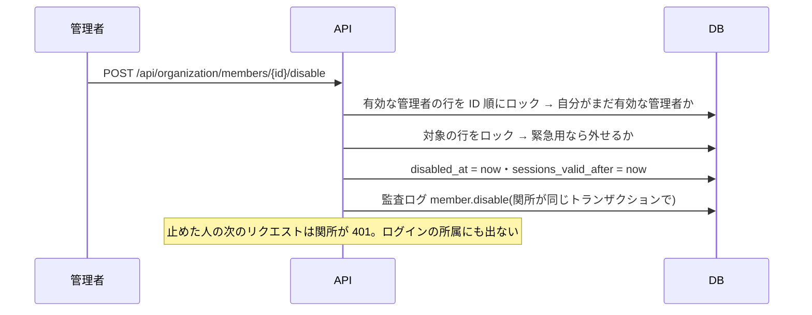
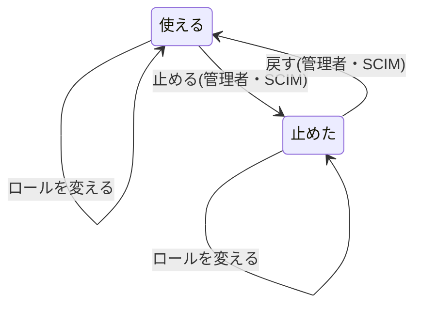

# 設計: 組織の人を止める(外す)・戻す・ロールを変える

> **AI 用の設計書。省略せずに網羅的に書く(正はこちら)。** 人はこれを開かず、PR の本文の「人向けのまとめ」を見る([guides/human-review.md](../guides/human-review.md))。
> 仕様: [docs/specs/0079-member-admin.md](../specs/0079-member-admin.md)
> 状態: 完了
> 観点の順は [review-viewpoints.md](../review-viewpoints.md)。当てはまらない節も消さずに「該当なし(理由)」と書く。

## 0. 全体像

管理者が「組織の人」の画面で、人を止める・戻す・ロールを変える。どれも `organizations.users` のその組織の行を書き換えるだけで、新しい表は作らない。止めるのは SCIM(仕様 0056)が使っている `disabled_at` と同じ列で、関所・ログイン・人数の数え方・メールの宛先がすでにそれを見ている(メールの宛先だけ、この設計で足した)。

## 作業の前に読んだ物(ガイド)

- `apps/api/src/domains/organizations/CLAUDE.md`・`docs/domain/organizations/README.md`
- 仕様と設計書 0027(招待)・0047(プラン。人数の上限で止めない)・0055(1人が複数の組織)・0056(SCIM の「消す = 止める」・緊急用の U-3)
- `src/authz/middleware.ts` の roleOf(ロールは毎回 DB から読む・disabled_at なら 401)
- `docs/authz/matrix.yaml`・`src/audit/actions.ts`(書き込みの API は1行ずつ)

## 1. 設計方針

- 外す = 止める(U-1)。行を消さないので、作った物の外部キー・監査ログの「誰が」・書き出しがそのまま使える。SCIM の「消す = 止める」(設計書 0056 の U-5)と同じ列・同じ意味にそろえる
- 守りは API の1か所(`members.ts`)。画面はボタンを出し分けるだけ
- 「有効な管理者を0人にしない」は、件数を数えるのではなく「操作する人が対象と別の有効な管理者であること」をロックの中で確かめて守る(数えるだけだと、同時の2つの操作が両方通る)

## 2. データモデル

- 新しい表・列は無い。`organizations.users.role` をアプリの接続(app_rw)が書けるように、移行 0024 で列の権限だけを足す(`GRANT UPDATE (role)`)。`disabled_at`・`sessions_valid_after`・`sso_exempt` は前から書ける
- 止めた人は `disabled_at` が入る。戻すと null。止めた時刻の前の値は監査ログにだけ残る

## 3. API

| API | 本文 | 返す | 監査ログ |
|---|---|---|---|
| `GET /api/organization/members` | — | 一覧(止めた人も出る。`disabledAt`・`scimManaged` を足した) | — |
| `PUT /api/organization/members/{memberId}/role` | `{ role }` | 変えた後の人(200) | member.role_change |
| `POST /api/organization/members/{memberId}/disable` | — | 止めた後の人(200) | member.disable |
| `POST /api/organization/members/{memberId}/enable` | — | 戻した後の人(200) | member.enable |
| `POST /api/organization/members/{memberId}/sign-out` | — | 204(前から) | member.sign_out |

- 失敗: 自分 → 409 `cannot_change_yourself`・最後の緊急用 → 409 `last_sso_exempt`・他社と無い人 → 404・操作の間に自分が管理者でなくなった → 403
- 止める・戻すを PATCH 1本にしないのは、監査ログの名前を API ごとに1つにするため(関所が API の名前から決める)
- 変えた先のロールは監査ログの details に入れない(details に値を入れない決まり。`src/audit/capture.ts`)。いまのロールは一覧で見る
- `scimManaged` = 生きている SCIM の鍵があり、その人のメールが組織の確かめたドメイン(SCIM の道具が扱える範囲。`scim.ts` の `inVerifiedDomain` を使い回す)

## 4. 状態遷移

## 5. システム間連携

- 情シスの道具(SCIM): 画面で止めても、道具が次に `active: true` を送れば戻る(U-2)。画面の確かめの文で知らせる
- メール: `findContact`(知らせの宛先)と `listUserIds`(規約のお知らせを積む先)が止めた人を返さない。タスクの完了・規約の変更・アカウントのお知らせは止めた人に届かない
- 1人が複数の組織に所属する人(仕様 0055): 止めるのはこの組織の行だけ。ほかの組織にはそのまま入れる

## 6. 業務ルール

- 自分は止められない・ロールを変えられない(409)
- 操作する管理者は、有効な管理者の行(ID 順)をロックしてから、自分がまだ有効な管理者かを見直す。違えば 403
- 管理者から外す・止めるとき、その人が緊急用なら緊急用からも外す。SSO を必須にしていて、ほかに有効な緊急用の管理者がいなければ 409(設計書 0056 の U-3 と同じ守り)
- 止めると、その組織のセッションも切る(`sessions_valid_after` = 今)
- 戻すとき、人数の上限は見ない(仕様 0047)。緊急用には戻さない
- 同じ状態への操作は何も変えずに 200

## 7. 要求との対応

| 受け入れ条件 | 設計 | テスト |
|---|---|---|
| 止めると次の操作から入れず、ログインもできない | 6・関所の disabled_at・auth_find_memberships | `members.int.test.ts`「止めると…」・`journey.spec.ts` の 8 |
| 止めた人は人数に数えない・戻すと数える | `seatUsage` が disabled_at を見る(前から) | `members.int.test.ts`・`journey.spec.ts` の 8 |
| 作った物は残る | 行を消さない | `journey.spec.ts`(9 で1人分が数えられる・書き出し) |
| 止めた人にメールを送らない | 5 | `members.int.test.ts`(findContact・listUserIds) |
| 戻した人は前のロールで入れる | 6 | `members.int.test.ts` |
| ロールが次の操作から効く | 関所が毎回 DB から読む | `members.int.test.ts`「変えると次のリクエストから効く」 |
| 止めた人・道具の人の印 | 3 の disabledAt・scimManaged | `members.int.test.ts`(scimManaged)・画面 |
| 監査ログ | 3 | `members.int.test.ts`・`audit-coverage.test.ts` |
| 自分は変えられない | 6 | `members.int.test.ts` |
| 権限の表 | `policy.ts`・`matrix.yaml` | `authz-matrix.int.test.ts`・`authz-coverage.test.ts` |

## 8. 非機能

- ロックは1組織の有効な管理者の行だけ(数人)。待ちは短い。ID 順に取るのでデッドロックしない
- 一覧の `scimManaged` は1行ごとの小さな exists(ドメインと鍵は組織ごとに数件)

## 9. このプロダクト特有

- A 社(工務店)の職人の出入りは多い。止めた人を一覧から消さないので、一覧が長くなる(今は古い順。止めた人を下にする並べ方は後で)

## 10. 観点ごとの扱い

| 観点 | 扱い | 中身 |
|---|---|---|
| 権限・他社 | 最重要 | 権限の表3行・他社 404・自分 409・同時の外し合い 403 |
| 認証 | 採用 | 止めた人のセッション・ログイン(前からの関所を使う) |
| 監査 | 採用 | 3つの名前 |
| DB の権限 | 採用 | 移行 0024(列の権限1つ) |
| 画面のアクセシビリティ | 機械で検証 | `narrow-screens.spec.ts` の axe |
| 性能 | 低優先 | 8 |

## 11. 決めたこと(AI が決めた。人に聞かなかった)

- 止める・戻す・ロールを API を分けた(監査ログの名前を1つずつにするため)
- 自分の操作は 403 ではなく 409(権限はあるが、状態として断る。IP の範囲の `allowlist_excludes_you` と同じ)
- 最後の緊急用は新しい code `last_sso_exempt` にした(`sso_exempt_required` は SSO の設定の画面の文で、意味が違う)
- 止めた人にメールを送らないよう `findContact`・`listUserIds` を直した(戻った人は、次のログインで規約の同意の画面が出るので、お知らせのメールが無くても困らない)

## 12. 未確定事項(AI の仮決め。人の承認と分けて追う)

| 番号 | 工程 | 種類 | 仮決め(設計した事実) | なぜそうしたか | 人が判断する問い | 状態 |
|---|---|---|---|---|---|---|
| U-1 | 要求 | 戻せないリスク | 外す = 止める。行・作った物・監査ログは残し、ログインと人数から外す。1人分のデータを消すのは運営の person-data(G-06) | 行ごと消すと、作った物の持ち主と監査ログの「誰が」が引けなくなり、戻せない。SCIM の「消す = 止める」とそろう | 辞めた人を外すとき、行を残して止める形でよいか | 承認(@attumkwg 2026-10-28 会話で回答「止める (Recommended)」) |
| U-2 | 要求 | 利用者の挙動 | 情シスの道具(SCIM)が扱う人も、画面で止める・戻す・ロールを変えられる。道具が次に「有効」を送れば戻る | 退職の当日に、道具の同期を待たずに止めたい。画面で「道具で管理」の印と確かめの文で知らせる | 道具で管理している人を、画面からも変えられるようにしてよいか | 承認(@attumkwg 2026-10-28 会話で回答「画面でもできる (Recommended)」) |

## 13. 作り直しの記録

- まだ無い。
