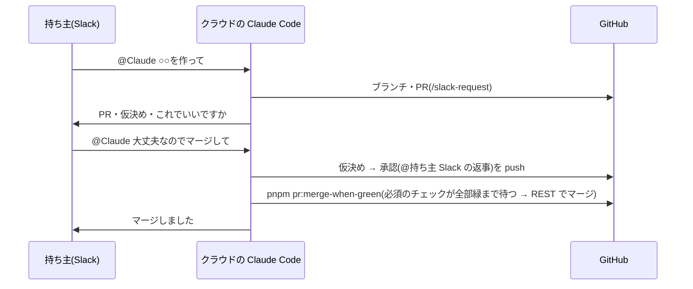

# 設計: Slack で頼むと、AI が PR を出し、持ち主の返事でマージまでする(1人の間)

> **AI 用の設計書。省略せずに網羅的に書く(正はこちら)。** 人はこれを開かず、PR の本文の「人向けのまとめ」を見る([guides/human-review.md](../guides/human-review.md))。
> 仕様: [docs/specs/0080-slack-requests.md](../specs/0080-slack-requests.md)
> 状態: 完了
> 観点の順は [review-viewpoints.md](../review-viewpoints.md)。当てはまらない節も消さずに「該当なし(理由)」と書く。

## 0. 全体像

## 作業の前に読んだ物(ガイド)

- `docs/guides/slack.md`(A・B・C)・`docs/guides/unattended-ai.md`・`docs/guides/local-guards.md`・`docs/guides/human-review.md` の 2
- 仕様 0061(答えの出どころ)・`.claude/hooks/guard-bash.mjs`・`.github/setup.yml`
- 公式の説明(2026-10-28 に確かめた): Claude Code in Slack(Pro・Max。終わると「Create PR」)・クラウドの環境(Docker あり・GitHub の中継は GraphQL を通さない・既定のコマンドの時間は2分)

## 1. 設計方針

- 既製品(Claude Code in Slack)を入口にし、キットには「手順(スキル)・合図の決まり・マージの関所・環境の準備」だけを足す
- 1人の間かどうかは、すでにある `.github/setup.yml` の `required_approvals` で決める(新しい設定を増やさない)
- AI のマージは1本のスクリプトに閉じ、フックはそのスクリプトだけを例外にする

## 2. データモデル

- 該当なし(DB は変えない)

## 3. API

- 該当なし(アプリの API は変えない)。GitHub は REST だけ: `GET pulls/{n}`・`GET rules/branches/main`・`GET commits/{sha}/check-runs`・`PUT pulls/{n}/merge`(sha つき・squash)

## 4. 状態遷移

- 未確定事項: `仮決め` → 持ち主の会話の返事 → `承認(@持ち主 日付 Slack の返事)`(か `変更(…)`)

## 5. システム間連携

- Slack ↔ クラウドの Claude Code: 既製品(公式)。キットは触らない
- クラウドの Claude Code → GitHub: 中継の REST。`gh pr create`・`gh pr merge` は使えない(GraphQL)
- CI: `scripts/decision-evidence.mjs` が土台のブランチの `setup.yml` で1人の間かを決める

## 6. 業務ルール

- 会話の答え: 状態の文に `Slack`・`チャット`・`会話` があり、GitHub のリンクが無い行。1人の間かつ `@持ち主` なら通す(`conversationAnswerProblems`)
- AI のマージ: `KIT_AI_MERGE=slack`(環境)・1人の間・PR が開いている・下書きでない・main 向け・必須のチェックが全部緑・待つ間に push が無い
- フック: コマンドに `KIT_AI_MERGE` があれば止める。スクリプトは環境に `KIT_AI_MERGE=slack` があるときだけ通す。ほかのマージの道(`gh pr merge`・`gh api … /merge`)は環境に関係なく止める

## 7. 要求との対応

| 受け入れ条件 | 設計 | テスト |
|---|---|---|
| 頼むと1本の PR・これでいいですか | `/slack-request` の 1〜3 | 持ち主がつないだ後の試し(`docs/guides/slack.md` の 5) |
| 返事で承認 → 緑でマージ | `/slack-request` の 4・`scripts/pr-merge-when-green.mjs` | `scripts/pr-merge.test.mjs`(判定)・試し |
| 落ちている間はマージしない | `checkState` | `pr-merge.test.mjs` |
| 手元ではマージできない | フックとスクリプトの変数の確かめ | `guard-bash.test.mjs` |
| 会話の答えを CI が認める・持ち主だけ | `conversationAnswerProblems` | `decisions.test.mjs` |
| 人が増えたら止まる | `soloFrom` | `decisions.test.mjs`・スクリプト |

## 8. 非機能

- 待つのは最大45分(E2E と結合で約10分)。クラウドのコマンドの時間を延ばす変数を環境に入れる(`docs/guides/slack.md`)

## 9. このプロダクト特有

- 該当なし(キットの進め方の変更)

## 10. 観点ごとの扱い

| 観点 | 扱い | 中身 |
|---|---|---|
| AI の権限 | 最重要 | マージの道を1本に閉じる・変数は持ち主だけ・人が増えたら止まる |
| 人の答えの確かさ | 採用 | 1人の間だけ会話を認める割り切り(ADR 0082) |
| CI | 採用 | 必須のチェックは減らさない |
| 費用 | 軽く確認 | 持ち主のプランの枠から |

## 11. 決めたこと(AI が決めた。人に聞かなかった)

- 1人の間の判定は `required_approvals: 0`(新しい設定を作らない)
- 合図の変数の名前は `KIT_AI_MERGE`(`KIT_EDIT_GUARD` と並べる)
- 必須のチェックは GitHub のルールセットと `setup.yml` の両方を合わせる(どちらかが古くても、厳しい方に倒す)
- `skipped`・`neutral` は緑とみなす(必須のチェックの中で、変更の範囲で飛ぶジョブがある)

## 12. 未確定事項(AI の仮決め。人の承認と分けて追う)

- なし(持ち主の答えは仕様の「決めたこと」)。

## 13. 作り直しの記録

- まだ無い。
