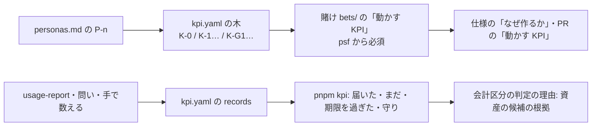

# 設計: ペルソナ → KPI → 計測 → 資産の線

> **AI 用の設計書。省略せずに網羅的に書く(正はこちら)。** 人はこれを開かず、PR の本文の「人向けのまとめ」を見る([guides/human-review.md](../guides/human-review.md))。
> 仕様: [docs/specs/0081-persona-kpi.md](../specs/0081-persona-kpi.md)
> 状態: 完了
> 観点の順は [review-viewpoints.md](../review-viewpoints.md)。当てはまらない節も消さずに「該当なし(理由)」と書く。

## 0. 全体像

## 作業の前に読んだ物(ガイド)

- `docs/guides/bets-and-assets.md`・`before-pmf.md`・`cost-dashboard.md`
- 仕様 0012(利用の記録)・0022(継続率)・0046(「無くなったら困るか」)・0020(賭けごとの損益)
- `.claude/skills/kickoff`・`bet`・`new-feature`・`slack-request`・`scripts/bets*.mjs`

## 1. 設計方針

- ファイルは2つ(人が読むペルソナは Markdown、機械が確かめる KPI は YAML)。新しい表や API は作らない
- 計測は今ある記録(`usage-report`・問い・費用のページ)を指すだけ。値は人か AI が `records` に足す
- 確かめは `pnpm kpi`(木)と `pnpm bets`(賭けのつなぎ)。どちらも CI の「Biome・型・単体」の中で流す

## 2. データモデル

- `docs/product/personas.md`: 見出し `## P-n …`。中身は自由な箇条書き(番号だけを機械が読む)
- `docs/product/kpi.yaml`: `north_star`(1つ)・`inputs`・`guardrails`・`records`。指標は `id`・`name`・`persona`(北極星と入力)・`why`・`measure { how: usage|survey|manual, feature | source, metric }`・`unit`・`target { value, by, direction }`(北極星と入力)・`limit { value, direction }`(守り)・`money`・`status`
- 金額の指標(`money: true`)は `target.value`・`limit.value`・`records[].value` を持たず、`records[].reached` だけ

## 3. API

- 該当なし(アプリは変えない)

## 4. 状態遷移

- 指標の `status`: 仮説 → 確か → やめた(消さない)
- 賭けの段階 psf に入るときに、ペルソナと動かす KPI が要る

## 5. システム間連携

- 機能フラグ(`packages/shared/src/feature-flags.ts`)の名前を読み、usage の指標の `feature` が無ければ知らせる(注の中の見本は数えない)

## 6. 業務ルール

- 木の形: 北極星 `K-0` が1つ・入力 `K-n` が 2〜4(やめた物を除く)・守り `K-Gn` が1以上
- 番号は重ならない。北極星と入力のペルソナは personas.md にある番号
- usage は `feature`、survey と manual は `source` が要る
- 賭け: psf・rollout・adopted は `- ペルソナ:` と `- 動かす KPI:` の行に番号が要る。どの段階でも、書いた番号は存在する物

## 7. 要求との対応

| 受け入れ条件 | 設計 | テスト |
|---|---|---|
| /kickoff で書かれる | `kickoff/SKILL.md` の A の 8.5・OK の後の 1.5 | 手順(機械では確かめない) |
| 最新の値と線の一覧 | `kpiReport` | `kpi.test.mjs`「最新の値と線を比べる」 |
| 形・番号・測り方の誤りで落ちる | `checkKpi` | `kpi.test.mjs` |
| 金額を書くと落ちる | `checkLine`・`checkRecords` | `kpi.test.mjs`「金額の指標は」 |
| 賭けのつなぎ | `betLinkProblems`・`bets.mjs` | `kpi.test.mjs`「賭けは psf から」 |
| 仕様・PR の欄 | `_template.md`・`pull_request_template.md` | — |
| 資産の根拠 | `bets-and-assets.md` | — |
| 見本 | `personas.md`・`kpi.yaml`・B-0001・B-0002 | `kpi.test.mjs`「キットの見本の木は通る」・`pnpm bets` |

## 8. 非機能

- 該当なし(ファイルを読むだけ。数百行まで)

## 9. このプロダクト特有

- 見本は TODO アプリ(架空)。自分のプロダクトでは `/kickoff` が書き直す

## 10. 観点ごとの扱い

| 観点 | 扱い | 中身 |
|---|---|---|
| 金額の漏れ | 採用 | 金額の指標は数を書くと落ちる |
| 使いやすさ | 採用 | idea・cpf は任意・目標が無くても落とさない |
| CI | 軽く確認 | 速い検査の中に1行 |

## 11. 決めたこと(AI が決めた。人に聞かなかった)

- KPI は YAML(機械が確かめる)、ペルソナは Markdown(人が読む)
- 北極星の番号は `K-0`、守りは `K-Gn`
- 目標の向きは `direction`(既定は above)
- まだ無い機能フラグを指す usage の指標は落とさない(作る前に決めるため)

## 12. 未確定事項(AI の仮決め。人の承認と分けて追う)

| 番号 | 工程 | 種類 | 仮決め(設計した事実) | なぜそうしたか | 人が判断する問い | 状態 |
|---|---|---|---|---|---|---|
| U-1 | 要求 | 事業判断 | KPI は北極星1つ+入力 2〜4+守り1つ以上の木 | 一番大事な物をぶらさず、伸ばす物と悪くしてはいけない物を分ける | KPI の木の形をこれにするか | 承認(@attumkwg 2026-10-28 会話で回答「北極星1つ+入力+守り (Recommended)」) |
| U-2 | 要求 | 利用者の挙動 | 賭けのペルソナと動かす KPI は psf から必須 | 作り込む前に何を動かすかを決める。思いつきは重くしない | どの段階から必須にするか | 承認(@attumkwg 2026-10-28 会話で回答「psf から必須 (Recommended)」) |
| U-3 | 設計 | 戻せないリスク | 割合と件数はリポジトリ、金額は非公開の置き場(リポジトリには届いたかだけ) | 公開されうるリポジトリに売上・費用の額を出さない | 値をどこに置くか | 承認(@attumkwg 2026-10-28 会話で回答「割合と件数はリポジトリ (Recommended)」) |
| U-4 | 設計 | 事業判断 | 資産か費用かの案に KPI の結果を根拠として並べ、確定は人 | 会計の判断はキットが決めない | 資産の判定に KPI をどう使うか | 承認(@attumkwg 2026-10-28 会話で回答「根拠として並べる (Recommended)」) |

## 13. 作り直しの記録

- まだ無い。
