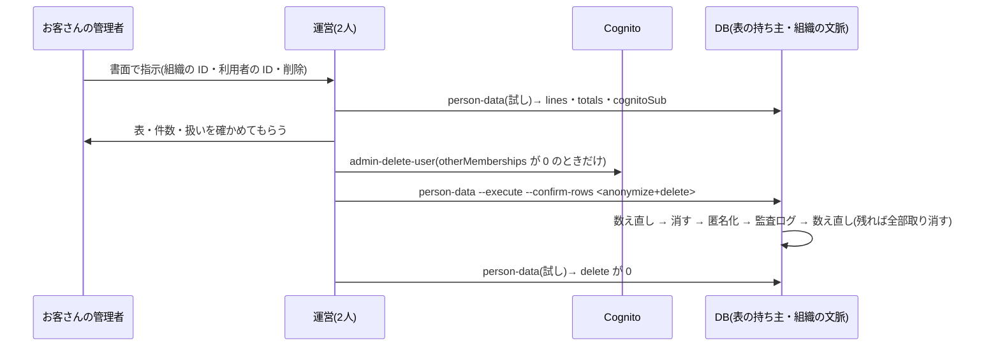

# 設計: 利用者1人分を消す・匿名化する運営のコマンド(試しと同じ一覧で)

> **AI 用の設計書。省略せずに網羅的に書く(正はこちら)。** 人はこれを開かず、PR の本文の「人向けのまとめ」を見る([guides/human-review.md](../guides/human-review.md))。
> 仕様: [docs/specs/0089-person-erase.md](../specs/0089-person-erase.md)・ADR: [0088](../adr/0088-person-erase-same-list-as-dry-run.md)。前の一歩は設計書 [0048](0048-person-data.md)(扱いの案 U-2 は承認済み)
> 状態: 完了
> 観点の順は [review-viewpoints.md](../review-viewpoints.md)。当てはまらない節も消さずに「該当なし(理由)」と書く。

## 0. 全体像

試し(`planPersonData`)と消す(`erasePersonData`)が、同じ一覧(`PERSON_REFERENCES`)と同じ条件(`personMatch`)を使う。消すのは1つのトランザクションで、終わる前に数え直す。

## 作業の前に読んだ物(ガイド)

- 仕様と設計書 0048・ADR 0059(試しと U-2)・ADR 0015(解約の `--execute --confirm-name`)・ADR 0013(監査ログは直さない)
- 既存のコード: `apps/api/src/person-data/plan-person-data.ts`・`apps/api/src/offboarding/delete-tenant.ts`(試し → 本番・運営の組織は消せない)・`apps/api/src/db/classification.ts`(personal の列)・`apps/api/src/audit/`(`recordAudit`・`MANUAL_AUDIT_ACTIONS`)・`apps/api/src/domains/organizations/members.ts`(止める = `disabled_at`・セッションを切る = `sessions_valid_after`)
- 移行: 外部キー(`(tenant_id, user_id)` → users)・一意の索引(users の email は組織ごと)・引き金(files だけ)
- 手順書 `docs/runbooks/person-data.md`・`docs/runbooks/offboarding.md` の 3(Cognito を先に)

## 1. 設計方針

- 置き場は `apps/api/src/person-data/erase-person-data.ts`(試しの隣)。入口は今の `person-data` に `--execute --confirm-rows <数>` を足す(`src/tenant-commands.ts`)。
- 試しの中身を `planPersonDataIn(tx, …)` に分け、消すコマンドが同じトランザクションの中で前と後に使う。条件は `personMatch(ref, who)` の1つだけ。
- 新しい依存は無い。表・列・移行も無い。

## 2. データモデル

- 表・列は足さない(移行なし)。
- 匿名化で置き換える列(`ANONYMIZE`):
  - `organizations.users`: `name` = 「削除した利用者」・`email` = `deleted-<行の ID>@invalid`・`external_id` = null・`scim_external_id` = null・`disabled_at` = 今(止めていなければ)・`sessions_valid_after` = 今
  - `organizations.invitations`: `email` = `deleted-<招待の ID>@invalid`(`accepted_user_id` でも、メールでも当たる行)
- 一覧の表で、消さず・置き換えない personal の列(`KEPT_PERSONAL_COLUMNS`): `files.files.name`・`projects.projects.name`(お客さんの業務の記録)・`organizations.support_sessions.staff_name`・`.staff_email`(運営の社員。本人ではない)。
- メールで指す列は、いまのメールと、**確かめ終えたメールの変更の前のメール**(`email_changes.previous_email`。`confirmed_at` がある物)で見る(設計書 0048 の 6 で「次の一歩で決める」とした所。試しも同じに直した)。
- 守り(結合テスト `person-erase.int.test.ts`):
  - 扱いが anonymize の表には `ANONYMIZE` がある
  - 一覧の表の personal・sensitive の列は、行ごと消す表か・`ANONYMIZE`・`KEPT_PERSONAL_COLUMNS` のどれかにある
  - `ANONYMIZE`・`KEPT_PERSONAL_COLUMNS` の列は、どれも列の分類にある(書き間違い)
  - 消した後、その組織の personal の列(残す物を除く)のどこにも、本人の名前・メール・古いメール・SCIM の ID が無い

## 3. API

- 該当なし(API は作らない)。
- CLI: `node dist/cli.js person-data <組織の ID> <利用者の ID> --execute --confirm-rows <数>` → `{"mode":"erased", …試しと同じ形(消す前の数)}`。試しは今のまま(`mode: "plan"`)で、最後の文を「まだ変えていません。… --execute --confirm-rows …」にした。
- `--execute` に `--confirm-rows` が無い・整数でない → 止まる。

## 4. 状態遷移

| 前 | 操作 | 後 |
|---|---|---|
| 有効・止めた | 消す | 止めた(「削除した利用者」・Cognito との結びつき無し) |
| 消した | 消す(流し直し) | 変わらない(匿名化の行だけ当たり、置き換える値は同じ。監査ログは1行増える) |

- 消した人を管理者が画面で「戻す」ことはできる(`member.enable`)が、メールが `@invalid` で Cognito と結びついていないのでログインできない。人数に数えられるだけ(手順書に書いた)。

## 5. システム間連携

- Cognito: 触らない。試しの `cognitoSub` と `otherMemberships` を見て、人が先に消す(手順書の 5。解約と同じ「外を先に」。匿名化で `external_id` を消すので、後からは sub が引けない。結果の JSON には消す前の sub が出る)。
- ECS: 移行と同じ1回きりのタスク。引数は ID と数だけ。

## 6. 業務ルール

- 1つのトランザクション(組織の文脈つき)で: 試しを数え直す → 数が `--confirm-rows` と違えば止める → delete の行を消す → anonymize の行を置き換える → 監査ログ → 数え直す。delete の行かメールで指す行が残っていれば投げる(全部取り消す)。
- 消すのが先・匿名化が後: メールで指す行は、消す前に読んだメールの組(`findPerson`)で探す。
- 監査ログ: その組織の `platform.audit_events` に `person.erase`(行為者 `system`・対象 `member` とその人の ID・details は `anonymize`・`delete` の件数だけ)。画面の文は「本人の求めで、その人のデータを消した」。
- 運営の組織(`SUPPORT_TENANT_ID`)では止める(社員の名前・メールは各組織の入室の記録に写っていて、組織1つの中で消しきれない)。
- その組織にいない人は止める(「いません」だけ。他社にいるかは言わない)。

## 7. 要求との対応

| 受け入れ条件(仕様) | 設計のどこ | テスト |
|---|---|---|
| 既定は試し | 3 | 既存の `person-data.int.test.ts`「何も変えない」 |
| `--confirm-rows` が違えば止まる | 6 | `person-erase.int.test.ts`「試しの数と --confirm-rows が違えば」 |
| 消した後の試しで delete が0 | 6 | 「消した後は、試しの delete が0で…」・E2E の 9 |
| personal の列に本人の値が残らない | 2 | 同上(列の分類の personal の列を全部探す) |
| 監査ログに件数つきで1行 | 6 | 「その組織の監査ログに…」 |
| 組織の人の一覧で「削除した利用者」・止めた | 2・4 | E2E `journey.spec.ts` の 9 |
| ほかの組織は変わらない | 6 | 「ほかの組織の同じ形の行は変わらない」 |
| 列が増えたら落ちる | 2 | 「一覧の表の personal・sensitive の列は…」 |
| 手順書 | — | `docs/runbooks/person-data.md` の 5 |

## 8. 非機能

- 性能: 1人分で試し2回(十数本の数える SQL ずつ)と、消す・置き換える SQL が十本ほど。1つのクエリ 5 秒の時間切れの内(監査ログは数えるだけで `tenant_id` で絞る)。
- セキュリティ: 仕様の STRIDE。出力・監査ログは ID と数だけ。
- 運用: 手順書 `docs/runbooks/person-data.md` の 5。
- 費用: なし。

## 9. このプロダクト特有

| 観点 | この変更では |
|---|---|
| テナント分離 | 組織の文脈と条件の `tenant_id` で絞る。結合テスト(2社) |
| 権限の表 | 変わらない(API なし) |
| 監査ログ | `person.erase` を足した(`MANUAL_AUDIT_ACTIONS`・画面の文 `audit-labels.ts`) |
| 解約で消す一覧 | 変わらない(一覧の表は全部 `TENANT_TABLES` にあることを既存のテストが見る) |
| サポートの代理ログイン | 社員の入室の記録は残す(`KEPT_PERSONAL_COLUMNS`)。運営の組織では止める |
| ログの個人情報 | 出さない |
| 列の分類(`personal` / `sensitive`) | 列は足さない。personal の列と消し方の突き合わせをテストに足した |
| 画面の部品 | 該当なし(監査ログの文を1行) |

## 10. 観点ごとの扱い

| 観点 | 扱い | 理由 |
|---|---|---|
| 設計方針 | 採用 | 試しと同じ一覧・同じ条件(ADR 0088) |
| 業務ルール | 最重要 | 戻せない。扱いは U-2 のまま |
| データモデル | 機械で検証 | 列の分類との突き合わせ・消し残しの結合テスト |
| 要求との対応 | 機械で検証 | 結合テスト・E2E |
| 非機能 | 軽く確認 | 1人分 |
| API・連携 | 低優先 | API なし。Cognito は手順書 |

## 11. 決めたこと(AI が決めた。人に聞かなかった)

- 同じコマンドに `--execute` を足す(別のコマンドにしない) — 数えた物と消す物を同じ一覧・同じ条件にするため。解約と同じ形(ADR 0088)。
- 確かめは `--confirm-rows <anonymize と delete の合計>` — 名前は引数に渡せない(CloudTrail)。2人で読み合わせた試しの数と、流す時の数を同じにする。
- 最後に数え直して、残れば全部取り消す — 一覧の条件と消し方がずれたときに、半分だけ消えた状態を作らない。
- 匿名化した人は止め、セッションを切る — 名前もメールも無い人が人数に入ったり、残ったセッションで入れたりしないように。U-2 の「匿名化」の中の作り方で、残す・消すの範囲は変えていない。
- 古いメール(確かめ終えた変更の前のメール)への招待も匿名化する — 本人のメールで、U-2 の「招待のメールは匿名化」に当たる。確かめていない変更の新しいメールは、本人の物か分からないので見ない。試しも同じに直した。
- 運営の組織では止める — 社員の名前は他の組織の入室の記録にも写るので、1組織の中では消しきれない(仕様 0048 の一覧の「社員が辞めたときに別に扱う」のまま)。
- 監査ログはその組織に残す(運営の組織ではない) — 解約と違い、その組織の監査ログは残る。お客さんの管理者が自分の画面で「いつ求めに応じたか」を見られる。
- Cognito はこれまでどおり人が先に消す — トランザクションの中で外を待たない決まり。解約と同じ順番。
- 匿名化のメールは行の ID から作る — 組織ごとの一意の索引に当たらず、`.invalid` は届かない(RFC 2606 の予約)。

## 12. 未確定事項(AI の仮決め。人の承認と分けて追う)

> 4つに当たる判断だけ。状態の書き方は [guides/human-review.md](../guides/human-review.md) の 2。`pnpm decisions` がここを読む。**`仮決め` が残る PR はマージしない。**

| 番号 | 工程 | 種類 | 仮決め(設計した事実) | なぜそうしたか | 人が判断する問い | 状態 |
|---|---|---|---|---|---|---|
| U-1 | 設計 | 戻せないリスク | 消すときの扱い(匿名化・削除・残す)と置き換え方は、設計書 0048 の U-2 のまま | 承認済みの案を、手の SQL からコマンドに移しただけ | — | 承認(設計書 0048 の U-2。@attumkwg 2026-10-25 会話で回答) |

## 13. 作り直しの記録

| 日付 | きっかけ | 入った工程 | 直した物 | 作り直した下流 |
|---|---|---|---|---|
