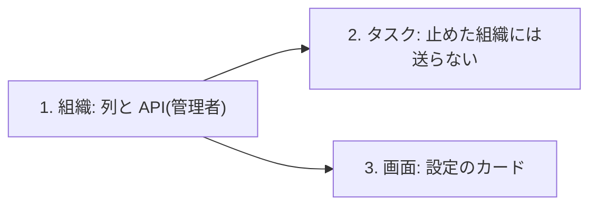

# 設計: 組織ごとに「タスクが完了したメール」を止める・戻す

> **AI 用の設計書。省略せずに網羅的に書く(正はこちら)。** 人はこれを開かず、PR の本文の「人向けのまとめ」を見る([guides/human-review.md](../guides/human-review.md))。
> 仕様: [docs/specs/0093-task-mail-switch.md](../specs/0093-task-mail-switch.md)
> 状態: 承認済み(承認した人: @attumkwg 2026-10-29 会話で回答)
> 観点の順は [review-viewpoints.md](../review-viewpoints.md)。当てはまらない節も消さずに「該当なし(理由)」と書く。

## 0. 全体像

組織の管理者が、その組織の「タスクが完了したメール」(仕様 0002)を止める・戻す。組織の表に1列(既定は送る)、管理者だけの API を3つ、送る直前に列を見て送らない、設定の画面にカードを1枚。子の Issue は3本(組織の領域 → タスクの領域と画面。後の2本は並べて進められる)。

## 作業の前に読んだ物(ガイド)

- 用語集・領域の説明: `docs/domain/organizations/README.md`・`docs/domain/tasks/README.md`
- 仕様: `docs/specs/0002-task-completed-mail.md`(送る直前に DB を読んで、送らない理由を `skip` で返す)・`docs/specs/0006-account-security.md`(組織の設定を管理者が入れ・切る型)
- 既存のコード: `apps/api/src/domains/organizations/mfa-requirement-routes.ts`(入れる・切るを POST / DELETE に分け、監査ログの名前で向きが分かる。details に値を入れない)・`apps/api/src/domains/tasks/notifications.ts`(`taskCompletedMail` が `{ skip }` を返すと送らずに済みにする)・`apps/web/src/pages/settings/MfaRequirementCard.tsx`(設定のカード)
- 領域の向き: `apps/api/src/domains/dependencies.ts`(tasks → organizations は使ってよい。`findContact` を既に使っている)

## 1. 設計方針

- 列は組織の表 `organizations.tenants` に置く(二段階認証の必須 `mfa_required` と同じ並び)。組織ごとの設定で、行は組織に1つ。新しい表は作らない(解約で消す一覧・RLS が今のまま効く)
- API は組織の領域に、二段階認証の必須と同じ形(GET で状態・POST で戻す・DELETE で止める)。向きを監査ログの名前で分ける
- タスクの領域は、組織の `index.ts` から読む関数を1つ使う(向きは今のまま)
- 新しい依存・部品は足さない

## 2. データモデル

- `organizations.tenants.task_completed_mail boolean not null default true`
- 移行は1段(列を足すだけ。既定値が定数なので Postgres 11 以上は表を書き直さない。squawk の `adding-field-with-default` に当たらない)。縮小の段は無い
- 列の分類: `pub("タスクが完了したメールを送るか")`(`apps/api/src/db/classification.ts`)
- 索引: 要らない(主キーで1行を読む)
- 解約で消す一覧: 組織の行ごと消える(今のまま)
- 書き出し: 組織の書き出しに列が増える(`exportOrganization` が列を選んでいるかは子1で確かめる)

## 3. API

| メソッドとパス | 入力 | 出力 | 権限 | 監査ログ |
|---|---|---|---|---|
| `GET /api/organization/task-mail` | なし | `{ enabled: boolean }`(`TaskMailSchema`) | `task_mail:manage`(admin) | なし |
| `POST /api/organization/task-mail` | なし | 204 | 同上 | `organization.task_mail_on` |
| `DELETE /api/organization/task-mail` | なし | 204 | 同上 | `organization.task_mail_off` |

- 失敗: 未ログイン 401・管理者でない 403(関所が返す)
- 権限の表: `docs/authz/matrix.yaml` に3行(admin 200/204・member 403・viewer 403・anonymous 401)
- 互換: 足すだけ

## 4. 状態遷移

- 送る ⇄ 止める。どちらからでも戻せる。同じ向きをもう一度は何も変えずに 204

## 5. システム間連携

- アウトボックスの出来事 `tasks.task_completed` は今のまま積む。受け手(`taskCompletedMail`)が送る直前に `findTaskMailEnabled(tx, tenantId)` を読み、false なら `{ skip: "mail_off_by_organization" }`(済みにして再送しない)
- 止めている組織の数: 運営は DB の集計で数える(`select count(*) from organizations.tenants where task_completed_mail = false`)。組織の名前は出さない。画面や API は作らない(仕様の受け入れ「数えられる」は集計で満たす)

## 6. 業務ルール

- 止める・戻すのは管理者だけ(`task_mail:manage` = admin)
- 既定は送る(列の既定値 true)
- 止めたかは送る直前に見る(出来事を積むときではない)

## 7. 要求との対応

| 受け入れ条件(仕様) | 設計のどこ | テスト |
|---|---|---|
| 管理者が止めると、完了してもメールが届かない | 3. API・5. 連携 | 子1 `test/integration/task-mail.int.test.ts`(止める・戻す)/ 子2 `test/integration/mail.int.test.ts`(止めた組織には送らない) |
| 管理者が戻すと、その後のメールは届く | 3. API・5. 連携 | 子2 `mail.int.test.ts`(戻した後は送る) |
| 管理者でない人には操作が出ない | 3. API(403)・画面(カードを出さない) | `authz-matrix`(3行)/ 子3 画面の単体テスト |
| 止めた・戻したが監査ログに残る | 3. API | `audit-coverage`・子1 の結合テスト |
| 止めている組織の数を数えられる | 5. 連携(集計) | 子1 の結合テストで列を読む |

## 8. 非機能

- 性能: 送る直前に主キーで1行読むだけ
- セキュリティ: 仕様の STRIDE のとおり(関所・監査ログ・テナントはセッションから)
- 運用: ログは今の `skip` の理由が出る(`mail_off_by_organization`)。アラーム・手順書は増えない
- 費用: 増えない(メールが減る)

## 9. このプロダクト特有

| 観点 | この変更では |
|---|---|
| テナント分離 | パスに組織の ID を取らない。`c.var.tx`(RLS)で自分の組織の行だけ |
| 権限の表 | 3行足す(危険度「高」) |
| 監査ログ | `organization.task_mail_on` / `_off` |
| 解約で消す一覧 | 変わらない(組織の行に乗る) |
| サポートの代理ログイン | 代理の社員は管理者として入らない限り操作できない(今の関所のまま) |
| ログの個人情報 | 出さない(真偽の値だけ) |
| 列の分類(`personal` / `sensitive`) | `pub` |
| 画面の部品 | 設定のカード(`packages/ui` の既存の部品だけ) |

## 10. 観点ごとの扱い

| 観点 | 扱い | 理由 |
|---|---|---|
| 設計方針 | 軽く確認 | 二段階認証の必須と同じ型 |
| データモデル | 機械で検証 | 列を1つ足すだけ(squawk・分類の CI) |
| API | 採用 | 管理者だけの3本 |
| 状態遷移 | 低優先 | 2つの値 |
| システム間連携 | 最重要 | 送る直前に見る・済みにして再送しない |
| 業務ルール | 採用 | 止める単位(U-1) |
| 要求との対応 | 機械で検証 | 結合テスト |
| 非機能 | 低優先 | 1行を読むだけ |
| 権限の表 | 最重要 | 危険度「高」 |

## 11. 決めたこと(AI が決めた。人に聞かなかった)

- 列は `organizations.tenants` に置く — 組織ごとの設定で、二段階認証の必須と同じ。新しい表を作ると解約・RLS・分類が増える
- API を POST / DELETE に分ける — 監査ログの details に値を入れない決まりのまま、名前で向きが分かる(二段階認証の必須と同じ)
- 送る直前に見る — 仕様 0002 の「送るまでの間に変わったら送らない」と同じ考え。止めた後に届く物を作らない
- 戻しても、止めていた間の出来事は送らない — 受け手が済みにするので、作りとしてそうなる。古い知らせをまとめて届けない
- 数えるのは DB の集計 — 運営の画面を作るほどの数ではない。名前は出さない(ID と集計まで)
- 子を3本に割る — 1つの Issue で触るのは1つの領域(`apps/api/src/domains/*/CLAUDE.md`)
- 意義の判断は条件つき(`docs/product/verdicts/2026-10-29-task-mail-switch.md`)。子の1と2で 4 人日を超えたら、3(画面)は作らずに判断し直す

## 12. 未確定事項(AI の仮決め。人の承認と分けて追う)

| 番号 | 工程 | 種類 | 仮決め(設計した事実) | なぜそうしたか | 人が判断する問い | 状態 |
|---|---|---|---|---|---|---|
| U-1 | 要求 | 利用者の挙動 | 止める単位は組織(管理者が止める) | B-0001 の撤退の線が組織の数で決まっている | 組織ごとでよいか、人ごとに止めたいか(人ごとなら列ではなく人の設定の表) | 承認(@attumkwg 2026-10-29 会話で回答「G-119 の U-1 は組織ごと(管理者が止める)」) |
| U-2 | 要求 | 戻せないリスク | 要配慮個人情報に当たらない | 「送る・送らない」の1つの値だけ。人が書く欄が無い | 当たらないでよいか | 承認(@attumkwg 2026-10-29 会話で回答「U-2 は要配慮個人情報に当たらない」) |

## 13. 作り直しの記録

| 日付 | きっかけ | 入った工程 | 直した物 | 作り直した下流 |
|---|---|---|---|---|
| 2026-10-29 | 受け入れの第1回の6([../acceptance/0093-task-mail-switch.md](../acceptance/0093-task-mail-switch.md)) | 設計 | 止めたかを送る直前にだけ見るので、止めている間に完了して、送り出しが動く前(1秒以内)に戻すと、その1通が届く。業務ルール「戻しても止めていた間の分は送らない」を守るには、完了した時点の状態も見る(出来事に止めていたかを積む・止めたときに未送信の分を済みにする など)。直すのは `/rework` | まだ(`/rework` の後に下流を足す) |
