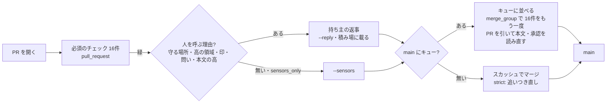

# 設計: 流量の受け皿(マージキュー・センサーだけで入れる範囲・AI の PR の上限の見直し)

> **AI 用の設計書。省略せずに網羅的に書く(正はこちら)。** 人はこれを開かず、PR の本文の「人向けのまとめ」を見る([guides/human-review.md](../guides/human-review.md))。
> 仕様: [docs/specs/0095-throughput.md](../specs/0095-throughput.md)・ADR [0094](../adr/0094-sensor-only-merge.md)
> 状態: 完了
> 観点の順は [review-viewpoints.md](../review-viewpoints.md)。当てはまらない節も消さずに「該当なし(理由)」と書く。

## 0. 全体像

## 作業の前に読んだ物(ガイド)

- 仕様と設計書 0051(組織に移してマージキュー)・0063(AI の費用と量の上限)・0085(人が決めることの一覧と積み場)・ADR 0082・0084・0085・0086
- `.github/setup.yml`・`scripts/setup/`・`scripts/pr-merge-*`・`.github/scripts/ai-open-prs*`・`.github/workflows/`(必須のチェックのある6つ)
- GitHub の文書(マージキューは `merge_group` の出来事でワークフローを動かす・キューの枝は `gh-readonly-queue/<土台>/pr-<番号>-<版>`・ルールセットの規則 `merge_queue` の鍵・キューに並べるのは GraphQL の `enqueuePullRequest`・if で飛ばされたジョブは必須のチェックで成功に数えられる)。2026-10-29 に、知っている範囲で書いた。入れる日に `pnpm setup:github` の試しで差分を見て確かめる

## 1. 設計方針

- **設定の正は `setup.yml` に1か所**。マージキューは `ruleset.merge_queue`、センサーだけのマージは `ai_merge.sensors_only`。どちらも既定はオフ。入れるのは人(`--apply`・持ち主の答え)。
- **守りを弱めずに流量を上げる**。キューを入れる日に必須のチェックを外さない。今までのチェックを全部キューでも流し、PR を見るチェックは PR を引いて読み直す。
- **人を呼ぶのは「人が決めること」があるときだけ**(人が決めることの一覧の「強制」の行)。それ以外の判断はセンサーに任せる。見分けの道具は、今ある `humanOnlyReasons`(守る場所・印)・`touchedAreas`(高の領域)・`prQuestions`(本文の問い)を合わせる。新しい判定を作らない。
- **上限は人の手に合わせる**。人を待つ本数(5)と全体の本数(20)の2つ。

## 2. データモデル

- `setup.yml`:
  - `ruleset.merge_queue`: `enabled`・`merge_method`(SQUASH・REBASE)・`max_entries_to_build`・`max_entries_to_merge`・`min_entries_to_merge`・`min_entries_to_merge_wait_minutes`・`grouping_strategy`(ALLGREEN だけ)・`check_response_timeout_minutes`。鍵の名前は GitHub のルールセットの規則 `merge_queue` の parameters と同じ(そのまま書く)
  - `ai_merge.sensors_only`: true / false(書かなければ false)
- `claude.yml` の env: `AI_OPEN_PR_LIMIT`(5)・`AI_OPEN_PR_TOTAL_LIMIT`(20)
- PR のコメント: 「## センサーだけでマージ(人を呼ばない範囲・ADR 0094)」(当てた版・緑だった必須のチェックの数・理由が無かったこと・入れ方)

## 3. API

- 該当なし(アプリの API は変えない)

## 4. 状態遷移

- PR: 開いた → 必須のチェックが緑 →(人を呼ぶ理由あり → 返事を待つ → 返事)/(理由なし・sensors_only → そのまま)→ キューに並ぶ(キューがあれば)→ キューの中で緑 → main。キューの中で落ちたら PR はキューから外れ、開いたまま。
- 背景の AI: 頼まれる → 前の段で数える(人を待つ < 5 かつ 全部 < 20)→ 動く / 動かない

## 5. システム間連携

- GitHub のルールセット(`pnpm setup:github` の `areas-ruleset.mjs`): `merge_queue` を扱う規則に足す。ただし `setup.yml` に `merge_queue` を書いたときだけ扱う(書かなければ画面で足した物を残す。仕様 0051 の「画面から足す」で入れた所を壊さない)。
- GitHub Actions の `merge_group`(`checks_requested`): `ci.yml`・`vrt.yml`(前から)・`pr-work.yml`・`high-risk-approvals.yml`・`decision-evidence.yml`(この PR)。
- GraphQL の `enqueuePullRequest`(`expectedHeadOid` で版を固定)。`pr-merge-when-green.mjs` だけが呼ぶ。通らない所(GraphQL を通さない中継)では止めて「人が Merge when ready で並べる」と出す。

## 6. 業務ルール(数の根拠)

### 【実測】(キット自身。2026-10-27〜29)

| 何 | 数 |
|---|---|
| `ci.yml` が PR で成功した回の長さ | 51回・中央値 3.0分・90% 3.5分・最大 4.5分 |
| `ci.yml` が main への push で成功した回の長さ | 34回・中央値 3.0分・90% 3.2分 |
| `vrt.yml` が成功した回の長さ | 54回・中央値 2.0分・90% 2.5分 |
| 直近60本の PR が開いてからマージまで | 中央値 32分・90% 167分 |
| 1日にマージした本数の最大 | 35本(10-27) |
| 直近60本のうち、人を呼ぶ理由が無かった(センサーだけで入れられた)PR | 11本(18%)。守る場所に触る 31本・印 26本・問い 40本(重なりあり) |

- キット自身は守りそのもの(CI・フック・スキル)を作るので、人を呼ぶ理由のある PR が多い。

### 【推定】

- **strict の直列の天井**: 1本ずつ「追いつく → CI を流し直す → マージ」なので、1日に入る本数 ≒ 動いている分数 ÷ 1本の時間(T)。キット自身の T は CI の 3〜4分+待ち。製品は E2E・結合が伸びて T ≒ 30分とみると、24時間止まらずに 48本・10時間で 20本。週200本(平日で1日40本)に届かない。落ちた PR・追いつき直しの手間でさらに下がる。
- **マージキュー**: 同時に確かめる数を N(5)、まとめて入れる数を最大5にすると、天井 ≒ 動いている分数 ÷ T × N。T=30分・10時間・N=5 で 1日 100本。キューで落ちる率を f とすると、おおよそ × (1 − f)。f が 2割なら 80本。週200本に届く。
- **人の返事**: 全部の PR で返事を待つと、週200本で200回。センサーだけで入れる所では、人を呼ぶ理由のある PR だけになる。製品の機能の PR(画面・API の中身)は、キット自身より守る場所に触る割合が低いと見込む。導入した後に `pnpm metrics` の人の介在率と積み場(`pnpm queue`)の件数で確かめる。
- **全体の天井 20 本**: 開いている本数 ≒ 1時間に入る本数 × 開いてから入るまでの時間(リトルの法則)。1日40本(10時間で 4本/時)× 0.5〜4時間 ≒ 2〜16本。キューの待ちを足して 20本。超えるときは CI の同時の数か費用が詰まっているので、新しく動かずに待つ。
- **人を待つ本数 5 本**: 今までの5本(設計書 0063 の U-1。導入時に決める)をそのまま使い、数え方だけを「人を待つ PR」に変えた。

### 決まり

- 人を呼ぶ理由(`sensorMergeBlockers`): 印 risk:high・tests:weakened・needs-human / 守る場所(`protected-paths.json`)と守りの場所(`HARNESS_PATHS`)/ 高の領域(`risk-areas.md`)/ 本文の「🧑‍⚖️」の問い / 本文の危険度「高」に印。1つでもあれば `--sensors` は止める。
- 緑になった後に、印・本文・問いをもう一度見る(待つ間に labeler・人が付けた物)。
- キューの中のチェック: キューの枝の名前から PR の番号を引けなければ落とす(黙って通さない)。

## 7. 要求との対応

| 受け入れ条件 | 設計 | テスト |
|---|---|---|
| キューの正と `--apply` | `config.mjs` の `mergeQueueProblems`・`areas-ruleset.mjs` の `queueRule`・`managedTypes` | `scripts/setup/check.test.mjs`・`plan.test.mjs` |
| 必須のチェックが全部キューでも流れる | `check-lib.mjs` の `checkRequired`・`usage.mjs` の `mergeGroup` | `check.test.mjs`・CI の `pnpm setup:check` |
| キューの中で PR を引いて読み直す | `.github/scripts/queue-pr*.mjs`・3つのワークフロー・`ci.yml` の API の互換 | `.github/scripts/queue-pr.test.mjs`・actionlint・zizmor |
| センサーだけで入れる | `pr-merge-lib.mjs` の `sensorsOnlyFrom`・`sensorMergeBlockers`・`sensorComment`・`mergeQueueOn`・`pr-merge-when-green.mjs` の `--sensors` | `scripts/pr-merge.test.mjs` |
| AI の PR の上限 | `ai-open-prs-lib.mjs` の `waitsOnHuman`・`judgeOpenPrs` | `.github/scripts/ai-open-prs.test.mjs`(積み場・マージの判定との写しの突き合わせも) |
| フック | `guard-bash.mjs` の `checkMerge` | `.claude/hooks/guard-bash.test.mjs` |
| 手順と数 | `docs/runbooks/move-to-org.md` の 3・`docs/guides/throughput.md` | 手順 |

## 8. 非機能

- CI の時間: キューの中では必須のチェックをもう一度全部流す(文書だけの PR でも重いジョブを省かない。`ci-scope.mjs` のまま)。同時に確かめる数だけ Actions の分数が増える。
- 費用: 公開のリポジトリの Actions は無料。非公開は分数で効く(費用のページの Actions の行で見る)。

## 9. このプロダクト特有

- キット自身は個人のリポジトリなのでキューは使えない。キット自身ではキューの中の動きを流して確かめられない(`merge_group` の動きは、使う人の組織のリポジトリで初めて流れる)。確かめるのは、`pnpm setup:check`(静的)・単体のテスト・actionlint まで。入れた日の手順(手順書の 3)に「文書だけの PR を1本キューに通す」を入れた。

## 10. 観点ごとの扱い

| 観点 | 扱い | 中身 |
|---|---|---|
| 守りを弱めない | 最重要 | 必須のチェックを外さない・キューで読み直す・飛ばされるジョブを落とす・人を呼ぶ理由の見分けは今ある物を合わせる |
| 戻せるか | 採用 | 両方とも `setup.yml` の1行で戻る(`--apply`)。センサーで入れた PR は revert できる |
| 数の正直さ | 採用 | 【実測】と【推定】を分ける。キット自身の数を製品の数として言わない |
| テナント・権限の表・N+1・ログ | 該当なし | アプリを変えない |

## 11. 決めたこと(AI が決めた。人に聞かなかった)

- キットの既定は両方オフ。使う人が選ぶ(ADR 0086 と同じ考え。ADR 0094)
- キューで流れないチェックを必須から外す手順(仕様 0051)をやめ、全部をキューでも流す。外すと、キューに並べた後の書き換えを見ない
- `setup.yml` に `merge_queue` を書かなければ、`pnpm setup:github` はキューを扱わない(画面で足した所を残す)。書いて `enabled: false` なら外す(設定の正に合わせる。試しで差分が出るので、人が見てから `--apply`)
- `grouping_strategy` は ALLGREEN だけを許す(HEADGREEN は先頭しか確かめず、まとめた途中の PR が赤でも入る)
- マージの方法は SQUASH か REBASE(直線の履歴なので MERGE は使えない。`allowed_merge_methods` に入っている物だけ)
- キューの中で PR を引く道は、キューの枝の名前(GitHub が作る形)。`merge_group` の出来事に PR の番号の欄が無いため
- 全体の天井は 20 本(6 の【推定】)。人を待つ本数は今の5本のまま
- 人を呼ぶ理由の見分けは、今の `humanOnlyReasons`・`touchedAreas`・`prQuestions` に、印 needs-human と本文の危険度「高」を足しただけ(新しい判定を作らない)
- 背景の AI(`claude.yml`)と `pr-merge-lib.mjs` は、`setup.yml` を依存なしで行ごとに読む(`soloFrom`・`requiredChecksFrom` と同じ)。写しの読み方は、テストで突き合わせる
- キューがある所の AI のマージは、マージせずにキューに並べる(`enqueuePullRequest`)。キューの中で必須のチェックをもう一度流すので、入る前の最後の確かめはキューがする
- AI が GraphQL で直接キューに並べる・自動マージを付けるのを、フックで止める(マージの道は `pnpm pr:merge-when-green` だけ。ADR 0086)

## 12. 未確定事項(AI の仮決め。人の承認と分けて追う)

- なし(キットの既定は両方オフで、オンにするかは使う人が `setup.yml` で選ぶ。持ち主への問いは PR の「🧑‍⚖️」に)。

## 13. 作り直しの記録

- まだ無い。
