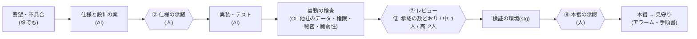

# 1枚でわかる: AI に作らせて、人が決める SaaS の作り方

> 経営者・情シス・決裁する人向け。会議にそのまま映せるよう1ページにした。詳しくは各行のリンク先。
> 数字は **【実測】**(このキットの中で測った・数えた)・**【推定】**(実測に決まった分数をかけた。前提は [roi.md](roi.md))・**【仮定】**(考え方の資料の目安。自社の数字に置き換える)を分けて書く。

## 3つの問いへの答え

- 💡 **なぜ意義があるか**: **やりたいことを、できるだけ早く使う人に届けて、実際に使ってもらう。それで世の中が少し良くなる**。SaaS はそのための装置で、このキットはその装置を作る工場。意義は作る人の楽さではなく、使う人の便利さにある。そのための手段が3つ: 🚀 早く届けられる(どの会社も最初に作る土台が最初からある・AI が依頼を PR まで流す)・🔒 届けた物を壊さない(他社のデータ・鍵・本番の事故を仕組みで止める)・📈 使われたかを確かめられる(機能ごとの賭け・使われ方と継続率を測り、使われなければやめる)。
- 🏭 **何者か**: 会社向け SaaS を作る**ソフトウェアファクトリー(工場)の雛形**。頼まれた1件を、AI が仕様 → 親子の Issue → PR → 受け入れに流す。流れを止めるのはセンサー(テスト・型・検査・E2E・計測)。人の仕事は「センサーが正しいかの判定」と「人が決めなければならないことに端的に答える」の2つに絞る(いまは3か所で止まる。下の「流れ」)。
- 📏 **物差し**: 毎週いちばん目に入る数は**無人化率**(人が使った工数の裏返し。入力の指標)。守りは**事故0件**と**センサーが正しいかの判定**。いちばんの物差し(北極星)は「意義があると判断した物が、使う人に届いて使われた数 ÷ 人の工数」= 人の1時間あたりに、使われる物をどれだけ届けたか。北極星を測る仕組みは、公開までに足す(下の「🔜 次に足す」)。
- 💴 **いくらで済むか**: 試すのは0円、本番は月 約8万円から(AWS の本番 約5.3万円+AI の席 1人 3万円〜)。

| このキット自身(2026-10-17〜10-29・1人+AI) | 数 |
|---|---|
| マージした PR(ボットを除く)と、AI が書いた割合 | 149本・100%【実測】 |
| 人が使った工数 | 約43〜68時間【推定】(PR を確かめる時間と答えた問い。指示・会話の時間は入らない) |
| 無人化率(有人化率)。毎週いちばん目に入る数 | 約78〜86%(約14〜22%)【推定】(全部を人が書いた場合の 約300時間 と比べて) |
| 人が答えた問い・人が手で直した PR | 305問・1本【実測】 |

| 手段 | 手に入る物(1行ずつは README の「何ができるか」) | 状態 |
|---|---|---|
| 🚀 早く届ける | 一言から仕様・親子の Issue・実装・テスト・PR・受け入れまで・16の必須のチェックとブランチ保護・事前登録から解約までの一周・押せる試作 | 動く(Slack から頼む道は使う側でつなぐ。1人分の削除は手順書で) |
| 🔒 壊さない | 他社のデータの分離・SSO と SCIM・ログインと二段階認証・招待と監査ログ・規約の同意と個人情報・依存と CVE の見張り・ISMS の準備 | 動く(本物の Cognito・IdP と ISMS の審査は型まで) |
| 📈 確かめる | 誰の困りごとかを決める・一部の会社にだけ出して測る・有人の工数を週ごとに見る(`pnpm metrics`)・賭けごとの損益・売る道具 | 動く(無人化率を1つの数で出すのは公開までに) |
| ⚙ 土台 | 画面と部品・ファイル・メール・本番の AWS 一式(Terraform)・見張り | 画面は動く・AWS は型まで(本物の AWS で一周していない) |

- 🔜 **次に足す(公開までに)**: 課金・個人データの場所の守り・人が決めることの一覧と判断待ちの積み場・依頼ごとの進み具合と流量の受け皿(週100〜200本)・北極星(使われた数 ÷ 人の工数)を測る・資産の累計と ROI の自動・無人化率を1つの数で。→ [roadmap.md](roadmap.md) の 6
- できないこと・確かめていないことは README の「🧾 できないこと・確かめていないこと」。

## 何が変わるか(3行)

- 🏭 **AI(Claude Code)が仕様・設計・実装・テストを作り、人は「判断が要る所」だけを決める**。人が止まるのは3か所(仕様の承認・危険度「中・高」のレビュー・本番の承認)。
- 🔒 **AI の事故は「お願い」ではなく手段で止める**: 本番の鍵を渡さない・危ない場所の変更は人の承認が要る・他社のデータは DB の層で見えない。
- 🧭 **作る前に確かめる**: 機能ごとに「当たるか」の線と期限を先に決め、外れたらやめる(賭け)。

## 流れ(人が止まる所)

- 番号は [playbook.md](../playbook.md) の9つの手順の番号(② ⑦ ⑨)。PdM の受け入れ(`/accept`)は、仕様の承認の後の確かめで、止まる所には数えない。
- 危険度は**変えた場所で自動で付く**(AI の自己申告に頼らない)。認証・認可・DB の移行・インフラ・CI は「高」。→ [concepts/line.md](../concepts/line.md) の 5

## 人と AI の分担

| | 人が決める | AI が作り、人が確かめる | AI に任せる | AI にやらせない(手段を外す) |
|---|---|---|---|---|
| 例 | 何を作るか・権限の表・お金と契約・本番の操作 | インフラ(Terraform)・DB の移行・CI | 危険度「低〜中」の実装・テスト・文書・依存の更新 | 本番の鍵とデータ・支払い・承認とマージ・顧客への連絡 |

- 人の比重は、土台を作る最初の2週間で6〜7割、3か月目から2〜3割 **【仮定】**。量は減っても**判断の重さは減らない**(「書く」から「決める・見る」へ)。→ [concepts/people-and-ai.md](../concepts/people-and-ai.md)
- 任せる範囲は、2か月ぶんの数字(変更の失敗率など)を見て1段ずつ広げ、事故が出たら1段戻す。

## 費用

| 段階 | 月の目安 | 中身 |
|---|---|---|
| 手元で試す・画面だけで確かめる | 0円 | AWS は要らない |
| 少人数に使ってもらう(検証の環境だけ) | 約2.2万円〜 | AWS |
| 本番を出す | 約5.3万円〜(検証・PR ごとの環境も入れて 約9.5万円〜) | AWS |
| AI の席 | 1人 月3万〜6万円 | Claude Code。速さの元なので削らない |
| 全体(PMF の前・2人) | 約13.5万〜23万円 | インフラ(本番+stg)+AI 2人+検査(無料の道具) |
| 全体(PMF の後・5人) | 約28万〜47万円 | 同上 |

- 数字は東京リージョンの定価からの見積もり **【仮定】**。本番の実際の費用は、費用のページが毎月出す(見積もりとの比べつき)。→ [concepts/stages.md](../concepts/stages.md) の 4・[guides/cost-dashboard.md](../guides/cost-dashboard.md)
- ほかに年1回の外部の脆弱性診断(数十万円〜)・人件費。

## 効果の見込み

| 見込み | 種類 | 根拠 | 自社で確かめる方法 |
|---|---|---|---|
| 手元で動かすまで30分。AWS も鍵も要らず、テスト462件が12秒で緑 | 【実測】 | 2026-10-29(`pnpm install` 32秒・`pnpm test` 12秒。[roi.md](roi.md)) | README の「👀 5分で見る」 |
| 1社が事前登録から解約までたどる E2E(10段)が18秒で緑。E2E の全部は38件が1分12秒 | 【実測】 | 2026-10-29(docker compose の上。[roi.md](roi.md)) | `pnpm test:e2e journey.spec.ts` |
| 人が使った工数は 約43〜68時間・無人化率 約78〜86%(このキット自身・149本の PR) | 【推定】 | PR の履歴 × `docs/cost/people.yaml` の分数([roi.md](roi.md) の 2) | `pnpm metrics` の「AI の PR で人の介入なし」と、費用のページの「人の時間」 |
| このキット自体を、1人+AI で13日・258コミットで作った。いちばん多い週は97本の PR をマージ | 【実測】 | 2026-10-29(このリポジトリの履歴。マージした PR 153・うちボット 4。97本は 2026-10-19〜25・持ち主が並列のセッションを回した結果) | — (自社の速さの約束ではない) |
| レビューに1日1〜2時間使える人が1人いれば、危険度「中」の小さな PR を週30〜50件 | 【仮定】 | 1件10〜20分の目安([concepts/line.md](../concepts/line.md) の 6) | `pnpm metrics` の「マージした PR」・「人が答えた問い」 |
| AI の PR のうち、人の手直しが要らない割合が上がる | 【仮定】 | 同じ失敗は2回目でルール・テスト・スキルにする(同 1 の 5) | `pnpm metrics` の「AI の PR で人の介入なし」を、変更の失敗率と並べて見る |
| AI に払う額は見合うか | 計算の型 | (浮いた人の時間 × 時給)− AI の費用。例: 5人で AI 月20万円なら、時給5,000円で月40時間浮けば元が取れる【仮定の例】 | 費用のページの「人の時間」と「賭けごとの損益」([guides/cost-dashboard.md](../guides/cost-dashboard.md)) |

- 📊 経営に出す数は「決裁用」(DORA の4つ+AI の割合・人の介在率)、チームが良くする数は「改善用」に分ける。**人ごとの数は出さない**。→ [guides/metrics.md](../guides/metrics.md)
- ⚠️ 導入する前の基準(いまの速さ)を測る道は、まだ無い(穴 G-54)。始める前の4週間のリードタイムだけでも手で控えておくと、比べられる。

## 情シス・審査で聞かれること

| 聞かれること | 答えの場所 |
|---|---|
| AI に何のデータを渡すか | ID と集計まで。本番の個人データは渡さない・要配慮は件数も渡さない → [compliance/ai-data.md](../compliance/ai-data.md) |
| どの外の会社にデータが行くか | 委託先の台帳(国・区分・契約・消え方。コードと CI で照らす)→ [compliance/vendors.md](../compliance/vendors.md) |
| AI が危ない操作をしないと言えるか | 手元のフック・CI・GitHub の設定の3層。危ない場所の一覧は1つ → [guides/local-guards.md](../guides/local-guards.md) |
| 他社のデータが混ざらないか | DB の層(RLS)+アプリ+全表のテストの重ね方 → [security.md](../security.md) |
| ISMS・P マークに使えるか | 管理策の一覧と適用宣言書・規程のひな形・毎月の証跡 → [compliance/README.md](../compliance/README.md) |
| 誰が・いつまで直すか(キット) | キットは作成中で、保守の日数も期限も約束しない(要る会社は自社か支援する会社で持つ)→ [maintenance.md](maintenance.md)・穴の知らせ方 [SECURITY.md](../../SECURITY.md) |
| セキュリティの質問票 | 根拠のリンクつきで下書きを作る `/security-questionnaire`(「はい」は本番で確かめた物だけ) |

## 向かない所(先に言う)

- 個人向けのアプリ・スマホのネイティブアプリが最初から要る・作る側の会社か部門が100人を超える → README の「こんな人のため」
- AWS・GitHub・Claude Code が前提(ほかに替えるときの地図は、まだ無い。穴 G-55)
